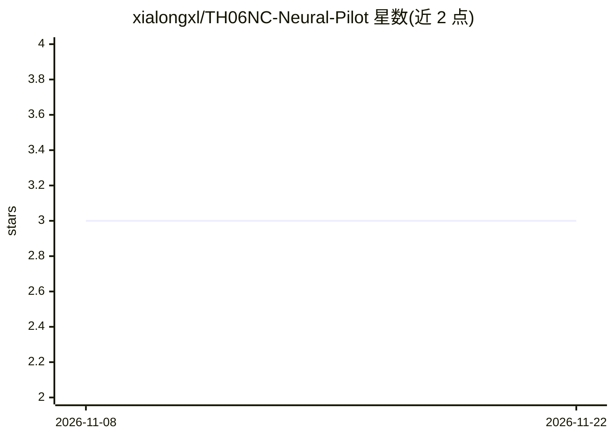

# xialongxl/TH06NC-Neural-Pilot

⭐ 3 · Python · MIT · 推送 2026-11-07 · [GitHub](https://github.com/xialongxl/TH06NC-Neural-Pilot) · 个人维护 · 中文 README

**用 PPO 强化学习玩东方红魔乡的游戏 AI 代理**

面向 Windows Steam 版《东方红魔乡 New Classic》的实验性强化学习代理：通过只读状态捕获观察运行中的游戏，以 PPO 策略结合滚动路径规划器完成躲避弹幕、拾取道具与瞄准射击，动作经标准 Windows 键盘输入执行。提供本地 Web 控制台管理训练/评估会话，支持断点续训、NMNB 目标与死亡前快照回看；附独立 GPU 看门狗（70°C/90% 显存/60 秒遥测停滞停机条件）。仓库仅含源码，需自备游戏副本并本地校准，验证基线为 Normal 难度 Reimu A，全通关与 NMNB 通关仍为研究目标。

## 筛选速览

| 维度 | 判定 | 备注 |
|---|---|---|
| AI 角色 | `ai-native` | 本体是模型或模型工具 |
| 许可风险 | `permissive` | MIT |
| 部署形态 | `desktop` | 安装包/桌面程序 |
| 模型依赖 | — | README 未给出锁定关系 |
| 硬件要求 | — | 无带数字的原话,不猜 |
| 安装摩擦 | `medium` | 含编译或系统依赖之一 |
| 成熟度 | — | 结构信号不足 |

## 能力要点

- PPO 策略 + 滚动路径规划器，输入延迟纳入路径检验
- 独立 GPU 看门狗：温度/显存/遥测三类默认停机条件
- 本地 Web 控制台（localhost REST + SSE）管理会话与回放
- 可选 Rust PyO3 扩展加速搜索、碰撞检测与状态捕获

## 适用场景

- 训练并评估可躲避弹幕的游戏 AI 策略
- 从已有 checkpoint 续训或回看策略游玩
- 研究 POMDP 游戏环境的强化学习流水线

## 场景标签

`强化学习` · 领域:训练与推理

## 证据(README 行号)

> L11: TH06NC-Neural-Pilot is an experimental reinforcement learning agent for the Windows Steam edition of **Touhou Kouma
> L28: |Python and GPU|Python 3.10, `uv`, and an NVIDIA driver compatible with the CUDA build of PyTorch installed by the 

## 星数曲线

2026-11-08 3 → 2026-11-22 3（+0）

---
*卡片 v1 · prompt 1.4 · 生成 2026-11-21 · 置信度 high · 依据 README sha `74ec26985b7e` · [字段定义](../../DATASET.md)*
