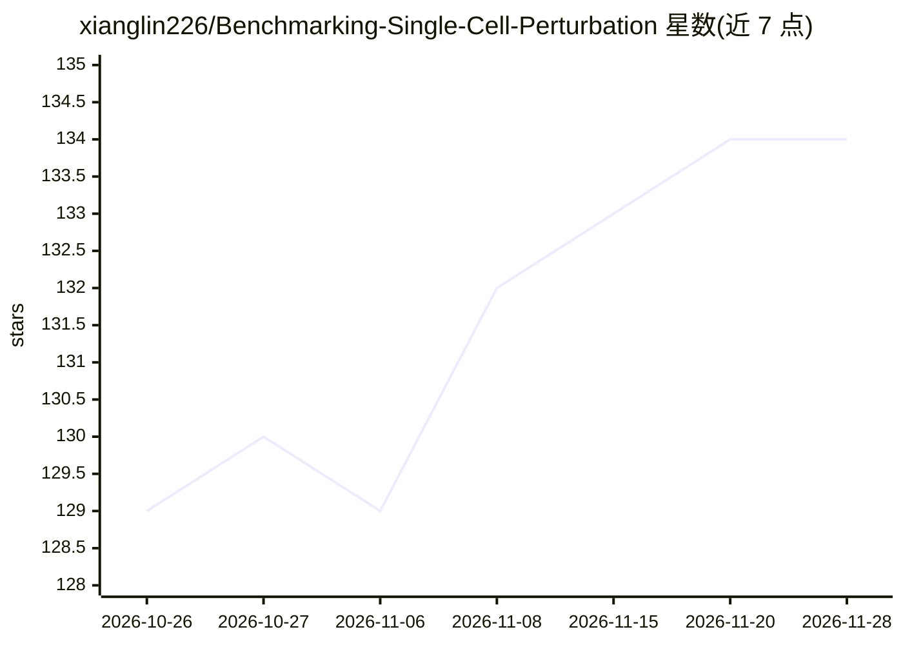

# xianglin226/Benchmarking-Single-Cell-Perturbation

⭐ 134 · HTML · Apache-2.0 · 推送 2026-11-04 · [GitHub](https://github.com/xianglin226/Benchmarking-Single-Cell-Perturbation) · 个人维护

**单细胞扰动响应模型/基准/数据集的策展指南清单**

以清单形式整理扰动响应预测领域的模型、分析方法、基准与数据集：每个条目给出年份、发表状态、特征范围、架构图链接与官方代码仓库链接。覆盖遗传与化学响应预测、空间上下文与细胞动力学、靶点发现、基准与数据集、单细胞基础模型等板块，并附交互式架构相似度图，收录 77 种扰动方法，边由策展的架构标签构成，注明不反映实测预测性能。不含安装或运行说明。

## 筛选速览

| 维度 | 判定 | 备注 |
|---|---|---|
| AI 角色 | `ai-knowledge` | 知识聚合/清单类 |
| 许可风险 | `permissive` | Apache-2.0 |
| 部署形态 | `None` |  |
| 模型依赖 | — | README 未给出锁定关系 |
| 硬件要求 | — | 无带数字的原话,不猜 |
| 安装摩擦 | `low` | 无编译、无系统依赖或容器化 |
| 成熟度 | — | 结构信号不足 |

## 能力要点

- 收录 77 种扰动方法的交互式架构相似度图（边基于策展架构标签）
- 每个模型条目附主论文链接、官方代码仓库与架构图链接
- 覆盖响应预测、空间动力学、靶点发现、基准与数据集等板块
- 标注预印本与正式发表年份，注明最后核查日期

## 适用场景

- 为单细胞扰动建模研究查找合适的模型与官方代码
- 按架构类型浏览相关扰动响应方法
- 查找该领域的基准与数据集资源

## 场景标签

`精选清单` `科研工具` · 领域:学习与行业

## 证据(README 行号)

> L5: A curated guide to perturbation-response models, analysis methods, benchmarks, and datasets.
> L19: Explore 77 perturbation methods by shared architecture, select a method to inspect its neighbors, and filter edges 

## 星数曲线

2026-10-26 129 → 2026-11-28 134（+5）

---
*卡片 v1 · prompt 1.4 · 生成 2026-11-28 · 置信度 high · 依据 README sha `03bdf6ff80b0` · [字段定义](../../DATASET.md)*
