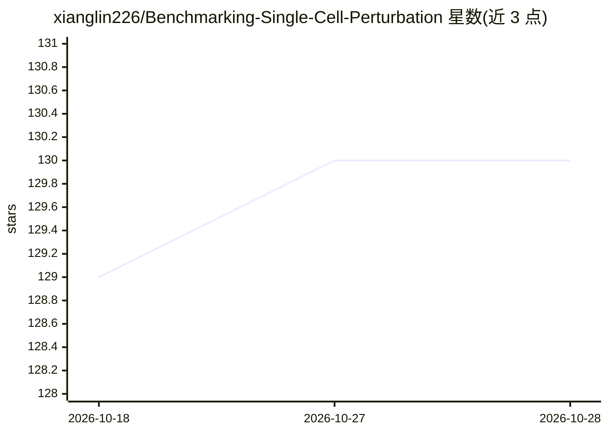

# xianglin226/Benchmarking-Single-Cell-Perturbation

⭐ 130 · Python · Apache-2.0 · 推送 2026-07-27 · [GitHub](https://github.com/xianglin226/Benchmarking-Single-Cell-Perturbation) · 个人维护

**单细胞扰动模型论文与数据集策展清单**

整理单细胞遗传/化学扰动建模研究的策展仓库：以表格收录 2018-2026 年约 60 篇扰动预测模型论文（含期刊/会议出处），另设综述、基准评测与竞赛、扰动数据集（SC-perturb、C-MAP、Tahoe-100M 及多项空间扰动测序数据）和单细胞基础模型清单等分区；并提及将基于 TDC 构建部分模型 API、附带 FastPert 查询工具与 CZI 数据库入口。面向扰动生物学与药物发现方向的研究者使用，条目定期更新。

## 筛选速览

| 维度 | 判定 | 备注 |
|---|---|---|
| AI 角色 | `ai-knowledge` | 知识聚合/清单类 |
| 许可风险 | `permissive` | Apache-2.0 |
| 部署形态 | `None` |  |
| 模型依赖 | — | README 未给出锁定关系 |
| 硬件要求 | — | 无带数字的原话,不猜 |
| 安装摩擦 | `low` | 无编译、无系统依赖或容器化 |
| 成熟度 | — | 结构信号不足 |

## 能力要点

- 按年份/期刊组织约 60 篇扰动模型论文表
- 收录基准评测与竞赛论文（PerturBench 等）
- 汇总 15 个扰动数据集（含空间扰动测序数据）
- 计划在 TDC 上构建部分模型 API 供基准测试

## 适用场景

- 查找单细胞扰动预测的模型论文与出处
- 了解该领域的基准评测与数据集资源
- 跟踪单细胞基础模型相关研究进展

## 场景标签

`精选清单` · 领域:学习与行业

## 证据(README 行号)

> L2: ## Models developed for genetic/chemical perturbation data
> L73: ## Benchmark and Challenges

## 星数曲线

2026-10-18 129 → 2026-10-28 130（+1）

---
*卡片 v1 · prompt 1.4 · 生成 2026-10-23 · 置信度 high · 依据 README sha `d5d1fd3e023a` · [字段定义](../../DATASET.md)*
