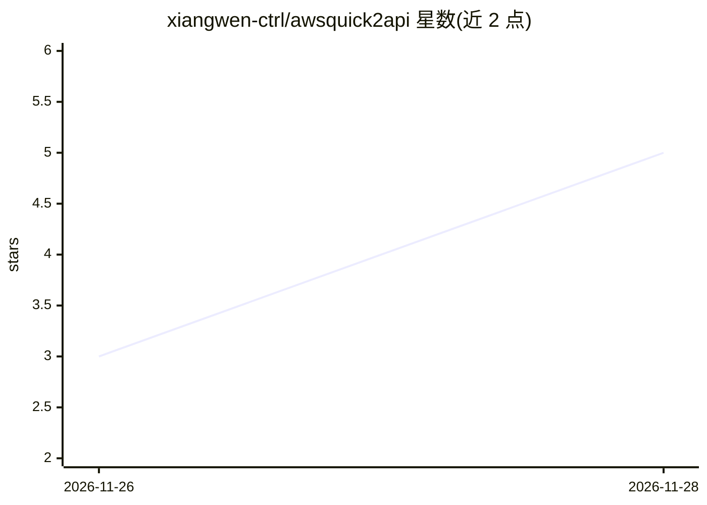

# xiangwen-ctrl/awsquick2api

⭐ 5 · Go · MIT · 推送 2026-11-27 · [GitHub](https://github.com/xiangwen-ctrl/awsquick2api) · 个人维护 · 中文 README

**给开发者提供把 Amazon Quick 转为 OpenAI/Anthropic 兼容 API 的自托管网关**

纯 Go 编写的单二进制自托管网关，将 Amazon Quick 账号封装为 OpenAI Chat Completions、Anthropic Messages 与 Codex Responses 兼容端点，覆盖流式输出、工具调用、JSON 模式与图片输入。面向需要以标准 API 接入客户端的开发者，提供多账号调度（加权/轮询/顺序）、令牌自动刷新与异常熔断、内置 Web 管理面板、账号凭据 AES-256-GCM 本地加密，以及隐私脱敏开关。声明为非官方协议适配工具，仅供个人学习与自有账号使用。

## 筛选速览

| 维度 | 判定 | 备注 |
|---|---|---|
| AI 角色 | `ai-ecosystem` | LLM/agent 周边工具 |
| 许可风险 | `permissive` | MIT |
| 部署形态 | `desktop` | 安装包/桌面程序 |
| 模型依赖 | locked-api |  |
| 硬件要求 | — | 无带数字的原话,不猜 |
| 安装摩擦 | `low` | 无编译、无系统依赖或容器化 |
| 成熟度 | — | 结构信号不足 |

## 能力要点

- OpenAI/Anthropic/Codex Responses 三协议兼容端点，含流式、工具调用与图片输入
- 多账号调度与容错：加权/轮询/顺序选号、令牌刷新与异常熔断
- 单二进制零外部依赖，内嵌 Web 管理面板与密钥分离设计
- 隐私脱敏（strict_privacy_dlp）屏蔽账号身份信息

## 适用场景

- 让仅支持 OpenAI/Anthropic API 的客户端调用 Amazon Quick 账号
- 管理多个 Quick 账号并按额度自动调度
- 在 Linux 服务器上以 systemd 私有部署 API 网关

## 场景标签

`模型网关` · 领域:Agent 开发

## 证据(README 行号)

> L8: AWSQuick2API 是一个纯 Go 编写的自托管网关，可将 Amazon Quick 账号封装为标准的 OpenAI、Anthropic（Claude Code）与 Codex Responses 兼容 API，并内置单页 W
> L12: - **多协议兼容**：支持 OpenAI (`/v1/chat/completions`)、Anthropic (`/v1/messages` 及 `count_tokens`) 与 Codex Responses (`/v1/

## 星数曲线

2026-11-26 3 → 2026-11-28 5（+2）

---
*卡片 v1 · prompt 1.4 · 生成 2026-11-26 · 置信度 high · 依据 README sha `33de04b7e292` · [字段定义](../../DATASET.md)*
