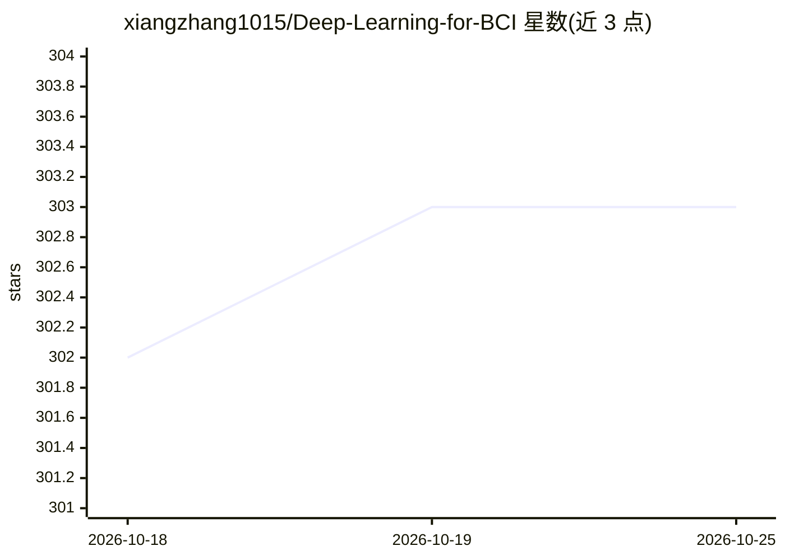

# xiangzhang1015/Deep-Learning-for-BCI

⭐ 303 · Jupyter Notebook · NOASSERTION · 推送 2026-08-14 · [GitHub](https://github.com/xiangzhang1015/Deep-Learning-for-BCI) · 组织维护

**BCI 教科书配套资源库：脑信号深度学习代码与数据集**

《Deep Learning for EEG-based Brain-Computer Interface》一书的配套仓库，提供可运行的 Python/Jupyter 教程代码，覆盖 BCI 全流程（数据获取、预处理、特征提取、分类、评估），并按章节链接 TensorFlow 实现仓库（用户识别、视觉重建、脑打字、癫痫检测等原型）。另整理 31 个公开脑信号数据集（EEG/ECoG/fNIRS/fMRI 等）的下载链接，并提供预处理好的 EEGMMIDB 版本（109 被试，.npy 格式）。要求 Python 3.7，CC BY-NC-SA 4.0 许可禁止商用。

## 筛选速览

| 维度 | 判定 | 备注 |
|---|---|---|
| AI 角色 | `ai-knowledge` | 知识聚合/清单类 |
| 许可风险 | `none` | NOASSERTION |
| 部署形态 | `library` | 以包/库形式分发 |
| 模型依赖 | — | README 未给出锁定关系 |
| 硬件要求 | — | 无带数字的原话,不猜 |
| 安装摩擦 | `low` | 无编译、无系统依赖或容器化 |
| 成熟度 | — | 结构信号不足 |

## 能力要点

- 31 个公开脑信号数据集的整理与下载链接
- 覆盖 MLP/RNN/CNN/VAE/GAN 等架构的教程代码
- EEGMMIDB 预处理即用版本（.npy，[N,65]）
- 按书籍章节链接 5 个配套 TensorFlow 代码仓库

## 适用场景

- 学习用深度学习对 EEG 等脑信号做分类
- 查找并获取公开 BCI 基准数据集
- 复现书中的癫痫检测、脑打字等原型实验

## 场景标签

`教程课程` `精选清单` · 领域:学习与行业

## 证据(README 行号)

> L9: *Companion repository for the book: Deep Learning for EEG-based Brain-Computer Interface: Representations, Algorithm
> L13: This repository contains implementable Python and Jupyter Notebook code alongside benchmark datasets for learning h
> L28: Brain signal collection is both financially and temporally costly. We curated 31 public datasets with download link

## 星数曲线

2026-10-18 302 → 2026-10-25 303（+1）

---
*卡片 v1 · prompt 1.4 · 生成 2026-10-21 · 置信度 high · 依据 README sha `500b79dfa900` · [字段定义](../../DATASET.md)*
