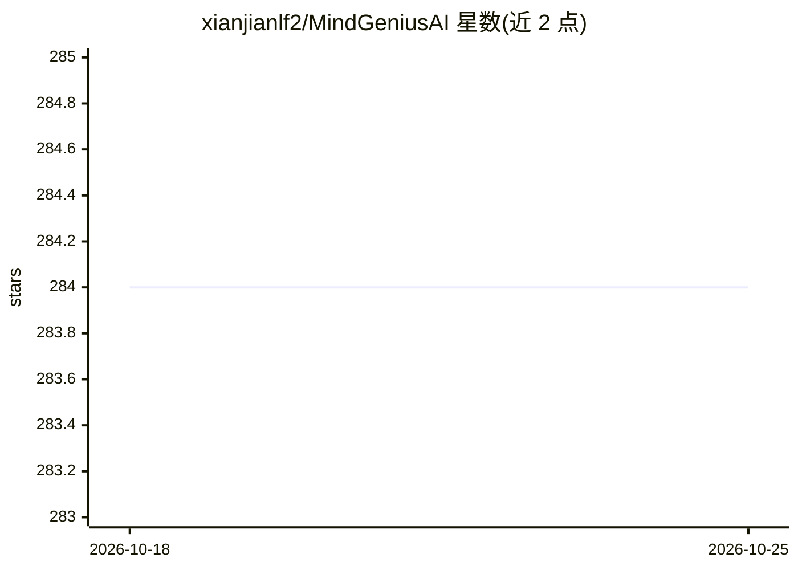

# xianjianlf2/MindGeniusAI

⭐ 284 · TypeScript · NOASSERTION · 推送 2026-06-29 · [GitHub](https://github.com/xianjianlf2/MindGeniusAI) · [官网](https://mindgenius.onrender.com) · 个人维护 · 中文 README

**自托管 AI agent：读取 PDF 生成并协作编辑思维导图**

面向注重隐私的知识工作者与自托管团队的可自部署 Web 应用：名为 Hermas 的 agent 通过多步工具循环（计划→检索→绘制→编辑）读取用户上传的 PDF，在内置 RAG（分块、嵌入、余弦检索，均在内存中完成）基础上生成可编辑思维导图，每个工具调用以卡片形式可见。支持 OpenAI/Claude/DeepSeek/Kimi 或任意 OpenAI 兼容端点，自带 API key（仅存于浏览器）。提供 pnpm 源码运行与单镜像 Docker 两种部署方式；采用 BSL 1.1 许可，商业使用需另行授权，各版本四年后转为 Apache-2.0。

## 筛选速览

| 维度 | 判定 | 备注 |
|---|---|---|
| AI 角色 | `ai-native` | 本体是模型或模型工具 |
| 许可风险 | `none` | NOASSERTION |
| 部署形态 | `self-host` | docker 或自建部署 |
| 模型依赖 | locked-api |  |
| 硬件要求 | — | 无带数字的原话,不猜 |
| 安装摩擦 | `low` | 无编译、无系统依赖或容器化 |
| 成熟度 | — | 结构信号不足 |

## 能力要点

- 多步 agent 工具循环（mindmap_generate/node_expand/rag_query/mindmap_edit），工具调用过程可见
- 内置约 100 行实现的 RAG：pdf-parse→分块→嵌入→余弦检索，全程内存中完成
- 双向画布：手工编辑与 agent 编辑共享同一操作模型，agent 可感知用户改动
- BYO-key 多 provider 接入，key 仅存浏览器，服务器不落盘

## 适用场景

- 把合同、论文、内部规格文档整理成思维导图
- 在自有服务器上部署处理敏感文档的 AI 导图工具
- 生成后手工微调导图并让 agent 基于改动继续迭代

## 场景标签

 · 领域:知识工具/文档可视化

## 证据(README 行号)

> L12: Chat with **Hermas**, an AI agent that plans, reads your PDFs, and draws editable mind maps live — every tool call 
> L48: - 📄 **Reads your PDFs** — attach one or more PDFs (📎): chunk → embed → in-memory retrieval (~100 lines, no LangChai

## 星数曲线

2026-10-18 284 → 2026-10-25 284（+0）

---
*卡片 v1 · prompt 1.4 · 生成 2026-10-22 · 置信度 high · 依据 README sha `afbbe3610cdd` · [字段定义](../../DATASET.md)*
