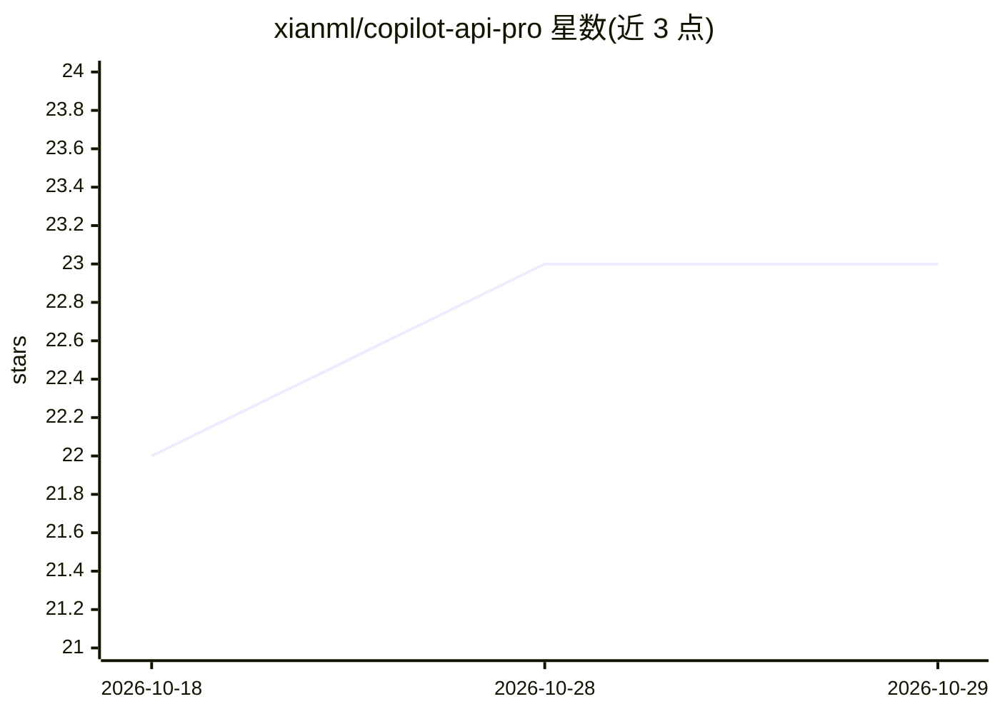

# xianml/copilot-api-pro

⭐ 23 · TypeScript · MIT · 推送 2025-12-10 · [GitHub](https://github.com/xianml/copilot-api-pro) · 个人维护

**让 Claude Code 与 Codex 通过 GitHub Copilot 账号使用的代理**

ericc-ch/copilot-api 的 fork，通过逆向工程的 GitHub Copilot 代理，使已有 Copilot 订阅的用户能在 Claude Code 和 Codex 中调用模型。提供 npx 命令行工具，支持 daemon 后台启停、持久化配置、用量检查与调试命令。README 声明该项目为非官方实现，可能随时失效。使用需具备 GitHub Copilot 账号并在设置中启用 copilot 模型。

## 筛选速览

| 维度 | 判定 | 备注 |
|---|---|---|
| AI 角色 | `ai-ecosystem` | LLM/agent 周边工具 |
| 许可风险 | `permissive` | MIT |
| 部署形态 | `library` | 以包/库形式分发 |
| 模型依赖 | — | README 未给出锁定关系 |
| 硬件要求 | — | 无带数字的原话,不猜 |
| 安装摩擦 | `low` | 无编译、无系统依赖或容器化 |
| 成熟度 | — | 结构信号不足 |

## 能力要点

- 同时支持 Codex 与 Claude Code
- daemon 友好的后台 start/stop 命令
- 为 Claude Code 与 Codex 提供持久化配置
- npx 一键运行，含 auth/check-usage/debug 子命令

## 适用场景

- 已有 GitHub Copilot 订阅的用户在 Claude Code 中使用模型
- 在 Codex 中复用 Copilot 账号额度
- 后台常驻运行代理并查看用量

## 场景标签

`模型网关` · 领域:Agent 开发

## 证据(README 行号)

> L9: > This is a reverse-engineered proxy of GitHub Copilot. It is unofficial and may break at any time.
> L13: This project supports both Claude Code and Codex with additional features:

## 星数曲线

2026-10-18 22 → 2026-10-29 23（+1）

---
*卡片 v1 · prompt 1.4 · 生成 2026-10-27 · 置信度 high · 依据 README sha `40e0bfd4f079` · [字段定义](../../DATASET.md)*
