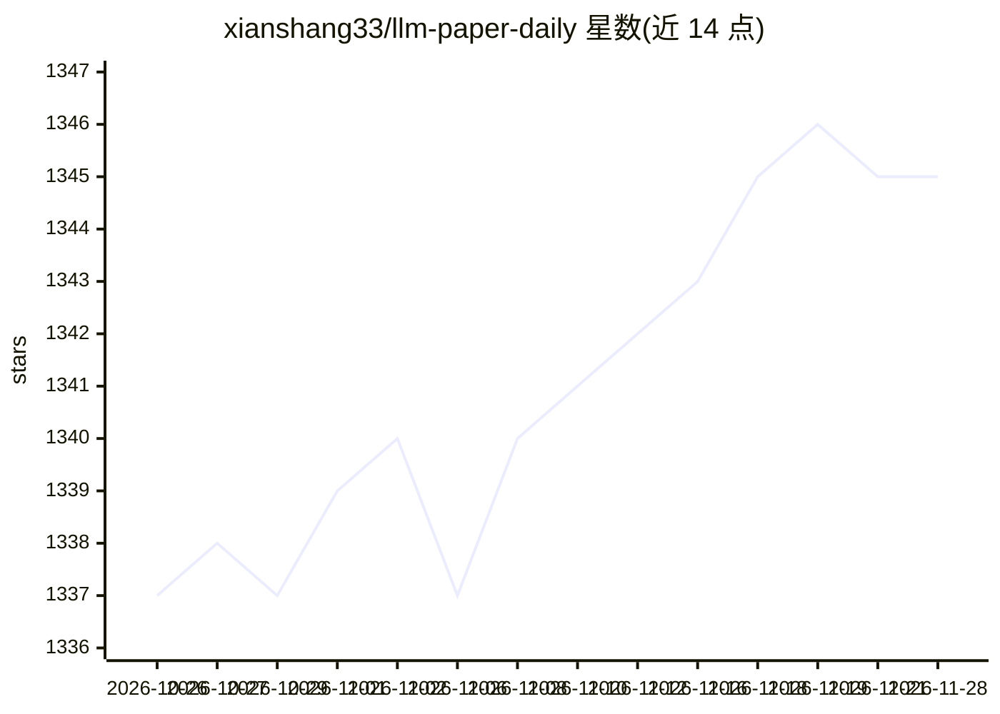

# xianshang33/llm-paper-daily

⭐ 1,345 · Python · 推送 2026-11-27 · [GitHub](https://github.com/xianshang33/llm-paper-daily) · 个人维护 · 中文 README

**每日更新的 LLM/Agent 研究论文精选订阅仓库**

该仓库按日汇总 LLM 与 Agent 相关的 arXiv 论文，每条附机构、arXiv 链接、GitHub 仓库与中文摘要，内容按月份日期列表组织。订阅方式为：用户将一段提示词发送给本地的 OpenClaw、Codex 或 Claude Code，由 Agent 按 SUBSCRIBE.md 创建本地配置、预览 digest 并安装定时任务；订阅流程只读取公开的 feed-papers.json，不在用户机器上运行抓取与总结流程。

## 筛选速览

| 维度 | 判定 | 备注 |
|---|---|---|
| AI 角色 | `ai-knowledge` | 知识聚合/清单类 |
| 许可风险 | `none` | — |
| 部署形态 | `None` |  |
| 模型依赖 | — | README 未给出锁定关系 |
| 硬件要求 | — | 无带数字的原话,不猜 |
| 安装摩擦 | `low` | 无编译、无系统依赖或容器化 |
| 成熟度 | — | 结构信号不足 |

## 能力要点

- 每日更新 LLM、Agent 相关论文，附 arXiv 地址与 GitHub 仓库链接
- 每条论文附中文总结
- 通过 paper-subscribe skill 配置本地订阅，只读取公开 feed-papers.json
- 支持定时任务推送 digest

## 适用场景

- 每天了解 LLM/Agent 方向的新论文
- 订阅后定时收到论文摘要推送
- 按论文附带的链接找到对应 arXiv 原文与代码仓库

## 场景标签

`科研工具` `精选清单` · 领域:学习与行业

## 证据(README 行号)

> L5: 欢迎来到 **llm-paper-daily**! 这是一个获取 LLM、Agent 相关研究论文的每日更新和分类平台。
> L7: 📚 **每日更新:** 仓库每天会带来最新的 LLM、Agent 相关研究，并附有 arXiv 地址、相关 GitHub 仓库和文章的总结。
> L25: Agent 会使用仓库里的 `paper-subscribe` skill，只读取公开的 `feed-papers.json`，不会在你的机器上运行论文抓取或总结生产流程。

## 星数曲线

2026-10-26 1,337 → 2026-11-28 1,345（+8）

---
*卡片 v1 · prompt 1.4 · 生成 2026-11-28 · 置信度 high · 依据 README sha `26897fa9afe6` · [字段定义](../../DATASET.md)*
