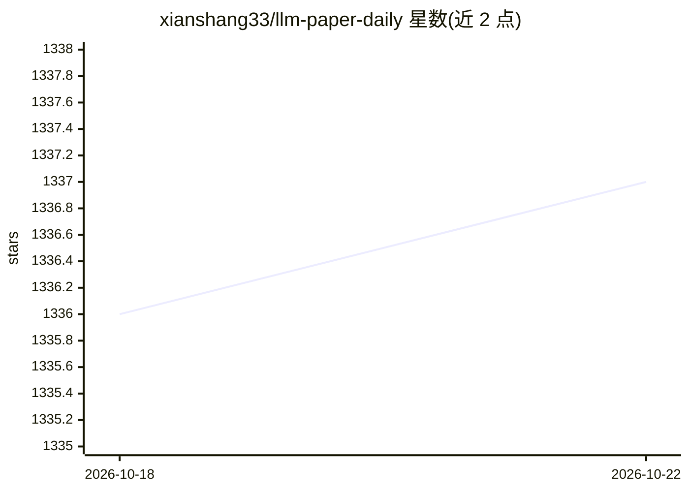

# xianshang33/llm-paper-daily

⭐ 1,337 · Python · 推送 2026-10-22 · [GitHub](https://github.com/xianshang33/llm-paper-daily) · 个人维护 · 中文 README

**每日更新的 LLM/Agent 论文精选清单（附 arXiv 链接与摘要）**

论文聚合仓库：每天收录最新 LLM 与 Agent 相关研究论文，条目附 arXiv 地址、相关 GitHub 仓库链接和中文总结，按日期以表格组织。订阅方式为将一段配置指令发送给本地 OpenClaw、Codex 或 Claude Code，由 Agent 调用仓库内的 paper-subscribe skill 读取公开的 feed-papers.json 完成本地定时任务配置。面向希望跟踪 LLM/Agent 研究进展的读者。

## 筛选速览

| 维度 | 判定 | 备注 |
|---|---|---|
| AI 角色 | `ai-knowledge` | 知识聚合/清单类 |
| 许可风险 | `none` | — |
| 部署形态 | `None` |  |
| 模型依赖 | — | README 未给出锁定关系 |
| 硬件要求 | — | 无带数字的原话,不猜 |
| 安装摩擦 | `medium` | 含编译或系统依赖之一 |
| 成熟度 | — | 结构信号不足 |

## 能力要点

- 每日收录 LLM/Agent 论文并附 arXiv 地址与总结
- 条目包含研究机构信息与相关 GitHub 仓库链接
- 通过向本地 Agent 发送指令完成订阅配置（paper-subscribe skill）

## 适用场景

- 每日跟踪 LLM 与 Agent 领域最新论文
- 通过本地 Agent 配置定时推送获取论文摘要
- 按日期浏览近期研究条目及其机构信息

## 场景标签

 · 领域:LLM/科研知识聚合

## 证据(README 行号)

> L5: 欢迎来到 **llm-paper-daily**! 这是一个获取 LLM、Agent 相关研究论文的每日更新和分类平台。
> L7: 📚 **每日更新:** 仓库每天会带来最新的 LLM、Agent 相关研究，并附有 arXiv 地址、相关 GitHub 仓库和文章的总结。

## 星数曲线

2026-10-18 1,336 → 2026-10-22 1,337（+1）

---
*卡片 v1 · prompt 1.4 · 生成 2026-10-21 · 置信度 high · 依据 README sha `1cfbab4d86ec` · [字段定义](../../DATASET.md)*
