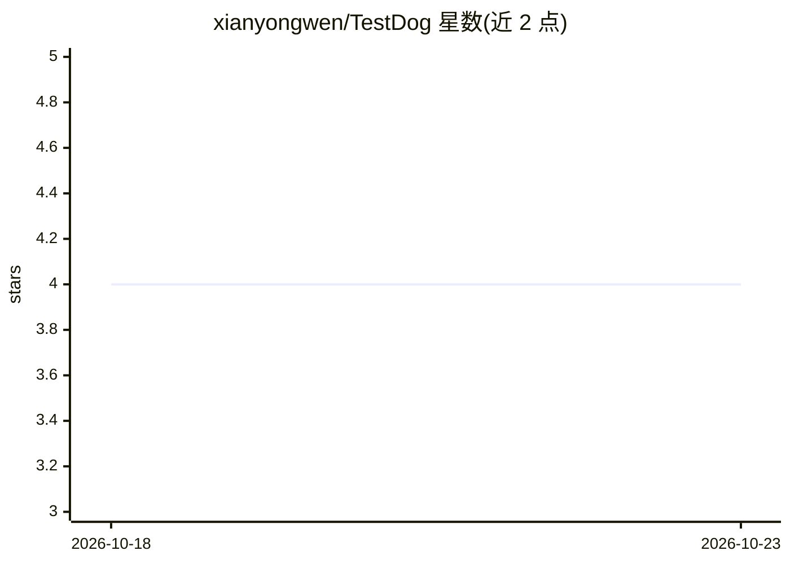

# xianyongwen/TestDog

⭐ — · [GitHub]() · 个人维护 · 中文 README

**Web 回归测试桌面工具：自然语言生成 Playwright 脚本并确定性回放**

面向 Web 应用端到端回归测试的本地桌面工具（Tauri + Node 后端）。用户用自然语言描述流程（或用 Playwright codegen 手动录制），模型经 OpenAI 兼容网关提出步骤计划，确认后逐步执行并落为可编辑的语义定位符脚本；保存后的脚本由 Playwright 确定性回放，包含 UI/API/WebSocket 断言，零 LLM 成本，定位符失效时可触发模型有界修复。数据存本地 SQLite，支持批量回放与 Excel 报告导出。需先安装系统 Chrome。

## 筛选速览

| 维度 | 判定 | 备注 |
|---|---|---|
| AI 角色 | `ai-enhanced` | 去掉 AI 部分产品仍成立 |
| 许可风险 | `permissive` | — |
| 部署形态 | `desktop` | 安装包/桌面程序 |
| 模型依赖 | — | README 未给出锁定关系 |
| 硬件要求 | — | 无带数字的原话,不猜 |
| 安装摩擦 | `low` | 无编译、无系统依赖或容器化 |
| 成熟度 | — | 结构信号不足 |

## 能力要点

- 自然语言/录制生成 Playwright 脚本，生成前需人工确认步骤计划
- 回放确定性执行，零 LLM token 消耗
- UI/API/WebSocket 断言与失败截图、控制台/网络证据留存
- 组件库语义插件覆盖 Ant Design/Element/Vant/MUI

## 适用场景

- Web 应用日常回归测试，脚本可反复回放不耗 token
- 从自然语言描述快速产出可维护的测试脚本
- 定位符失效后由 AI 提出修复建议再人工采纳

## 场景标签

`浏览器自动化` `代码生成` · 领域:效率与自动化

## 证据(README 行号)

> L31: |Ordinary replay and assertions|No|Saved steps run deterministically with Playwright; UI, API, and WebSocket checks
> L21: - **Replay without an LLM**: run saved scripts with Playwright, including UI, API, and WebSocket assertions; batch-

## 星数曲线

2026-10-18 4 → 2026-10-23 4（+0）

---
*卡片 v1 · prompt 1.4 · 生成 2026-10-18 · 置信度 high · 依据 README sha `e2d010ab5a74` · [字段定义](../../DATASET.md)*
