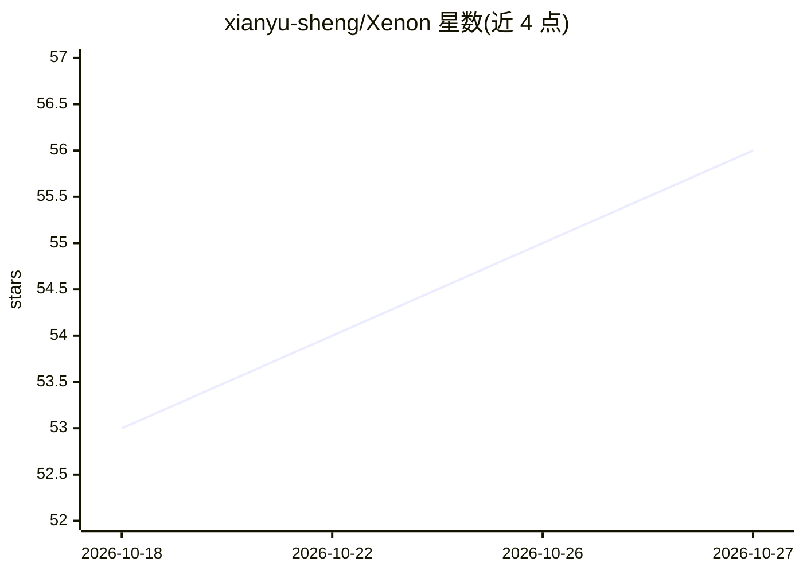

# xianyu-sheng/Xenon

⭐ 56 · Python · MIT · 推送 2026-10-26 · [GitHub](https://github.com/xianyu-sheng/Xenon) · [官网](https://github.com/xianyu-sheng/Xenon#readme) · 个人维护 · 中文 README

**终端 AI 编码代理：用哈希链证据与人工核验清单区分机器确认与语义判断**

面向开发者的终端 AI 编码代理（harness），把交付结果分为机器验证与需人工核验两部分：工具调用写入执行账本并形成 append-only 哈希链审计日志，/evidence 可随时重算自证；回合级阻断结构校验（空洞回答检测），语义问题不阻断而是整理成待人工核验清单。支持 6 种引擎 + MCP、多模型、/rewind 与 /fork 会话树、越权操作审批面板、来源与可信度标注、提示注入告警。Windows/CJK 输入有专门支持。经 GitHub Releases 提供 wheel 安装，不依赖 PyPI。README 明确声明边界：哈希链证明过程不证明结论，沙箱非真隔离。

## 筛选速览

| 维度 | 判定 | 备注 |
|---|---|---|
| AI 角色 | `ai-ecosystem` | LLM/agent 周边工具 |
| 许可风险 | `permissive` | MIT |
| 部署形态 | `library` | 以包/库形式分发 |
| 模型依赖 | locked-api |  |
| 硬件要求 | — | 无带数字的原话,不猜 |
| 安装摩擦 | `low` | 无编译、无系统依赖或容器化 |
| 成熟度 | — | 结构信号不足 |

## 能力要点

- append-only 哈希证据链（可选 HMAC 密钥锚点），/evidence 随时重算自证
- 回合级空洞回答结构校验，同回合反馈重试与同因熔断
- 语义问题整理为待人工核验清单随答案输出
- 支持 6 种引擎 + MCP、多模型、/rewind 与 /fork 会话树、越权审批与提示注入告警

## 适用场景

- 终端里做 AI 编码并事后核验 agent 过程证据
- 需要区分机器确认与人工判断的编码任务交付
- Windows 与中文输入法环境下的命令行编码代理
- 通过 MCP 扩展工具与子代理

## 场景标签

`编码 Agent` · 领域:编码与开发

## 证据(README 行号)

> L12:  把"机器到底验证了什么"摊开给你看的终端 AI 编码代理
> L94:  证据链，而不是日志 工具执行写入执行账本，会话层另有一条 append-only 审计链；<code>/evidence</code> 随时重算会话链自证，能发现损坏、单点篡改与重排。执行 claim/plan/delivery
> L119: `xenon/turn/gate.py` 负责回合级 L1/L2 校验；Reflection 引擎的 reviewer 评分是独立的输出质量审查，不作为工具事实或 Claim 的证明。工具成败只由工具回执决定，不靠关键词猜。

## 星数曲线

2026-10-18 53 → 2026-10-27 56（+3）

---
*卡片 v1 · prompt 1.4 · 生成 2026-10-24 · 置信度 mid · 依据 README sha `dfd1591d9558` · [字段定义](../../DATASET.md)*
