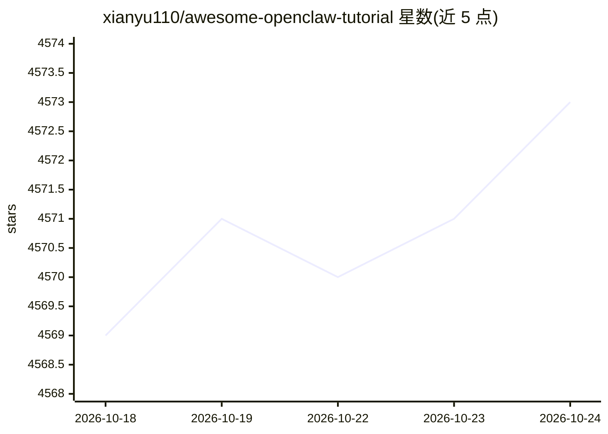

# xianyu110/awesome-openclaw-tutorial

⭐ 4,573 · Shell · NOASSERTION · 推送 2026-10-04 · [GitHub](https://github.com/xianyu110/awesome-openclaw-tutorial) · [官网](https://awesome.tryopenclaw.asia/) · 个人维护 · 中文 README

**OpenClaw 中文教程仓库：408,000字教程+避坑指南**

个人作者维护的 OpenClaw（AI 工作助手框架）中文教程仓库，含 15 章正文与 15 个附录，共约 408,000 字，覆盖安装部署（飞书妙搭/宝塔/云端/本地等 8 平台）、Skills 扩展、飞书/企微/钉钉多平台集成、70+ 实战工作流与避坑指南。当前按 OpenClaw v2026.9.3 稳定版校对，部分章节仍保留历史内容作参考；另有清华大学出版社出版的纸质书版本。面向新手、知识工作者与开发者。

## 筛选速览

| 维度 | 判定 | 备注 |
|---|---|---|
| AI 角色 | `ai-knowledge` | 知识聚合/清单类 |
| 许可风险 | `none` | NOASSERTION |
| 部署形态 | `library` | 以包/库形式分发 |
| 模型依赖 | — | README 未给出锁定关系 |
| 硬件要求 | — | 无带数字的原话,不猜 |
| 安装摩擦 | `low` | 无编译、无系统依赖或容器化 |
| 成熟度 | — | 结构信号不足 |

## 能力要点

- 15 章节正文 + 15 附录，约 408,000 字，含 70+ 实战案例
- 明确标注教程基线版本（v2026.9.3）与各章节新旧状态差异
- 覆盖 8 个平台的一键部署路径与国产模型成本对比
- 另有清华大学出版社纸质书（在开源教程基础上重写）

## 适用场景

- 从零开始安装部署 OpenClaw 并接入飞书等国内 IM
- 学习 Skills 扩展与自动化工作流配置
- 跨版本升级时查对照表与避坑指南
- 对比不同部署方案与模型 API 的成本

## 场景标签

`教程课程` · 领域:学习与行业

## 证据(README 行号)

> L4: > 从零开始打造你的AI工作助手：最全面的中文教程，涵盖安装、配置、实战案例和避坑指南
> L253: - ✅ **15章节正文**：约267,000字

## 星数曲线

2026-10-18 4,569 → 2026-10-24 4,573（+4）

---
*卡片 v1 · prompt 1.4 · 生成 2026-10-20 · 置信度 mid · 依据 README sha `6ab6a7682005` · [字段定义](../../DATASET.md)*
