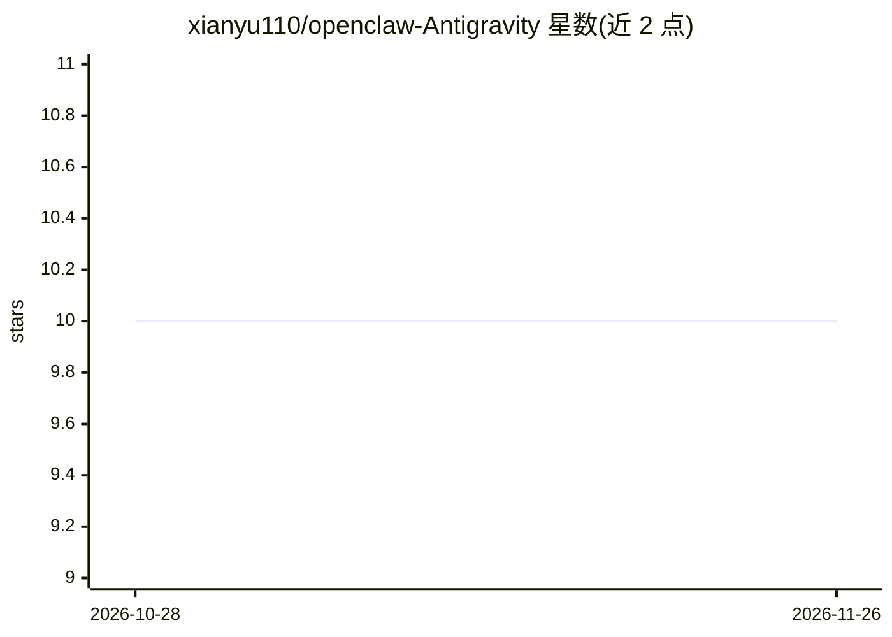

# xianyu110/openclaw-Antigravity

⭐ 10 · 推送 2026-02-05 · [GitHub](https://github.com/xianyu110/openclaw-Antigravity) · 个人维护 · 中文 README

**OpenClaw+Antigravity 组合配置教程：本地代理接入多模型**

一篇中文配置教程，讲解如何将 AI 助手框架 OpenClaw（含 Clawdbot 引擎与 ClawHub 技能市场）与本地 API 代理工具 Antigravity Manager 组合使用：安装 Antigravity Manager 桌面安装包、配置 Claude/Gemini/OpenAI 的 API 密钥、生成 User Token，并通过 jq 修改 clawdbot.json 将 Clawdbot 的模型接入本地 127.0.0.1:8045 服务。覆盖三个模型（Sonnet 4.5、Opus 4.5 Thinking、Gemini 3 Pro Image）的配置、切换命令、故障排查与配置备份。文中含第三方账号售卖推荐内容。

## 筛选速览

| 维度 | 判定 | 备注 |
|---|---|---|
| AI 角色 | `ai-knowledge` | 知识聚合/清单类 |
| 许可风险 | `none` | — |
| 部署形态 | `desktop` | 安装包/桌面程序 |
| 模型依赖 | — | README 未给出锁定关系 |
| 硬件要求 | — | 无带数字的原话,不猜 |
| 安装摩擦 | `low` | 无编译、无系统依赖或容器化 |
| 成熟度 | — | 结构信号不足 |

## 能力要点

- 分步讲解 Antigravity Manager 在 macOS/Windows/Linux 的安装包安装
- 通过 jq 修改 clawdbot.json 配置本地 provider 接入三个模型
- 提供模型切换、别名配置、成本追踪与配置备份命令
- 包含模型列表为空、连接失败等四类故障排查

## 适用场景

- 想让 Clawdbot 通过本地代理访问 Claude/Gemini 等多个模型
- 想统一管理多个 AI 服务商的 API 密钥
- 想在 OpenClaw 中切换推理模型或多模态模型

## 场景标签

`教程课程` · 领域:学习与行业

## 证据(README 行号)

> L1: # OpenClaw+Antigravity配置完全指南：从入门到精通
> L11: OpenClaw是一个开源的AI助手框架，包括：
> L18: Antigravity Manager是一个AI API代理工具，可以让你通过本地服务访问多个AI模型（Claude、Gemini、GPT等），统一管理API密钥和请求。

## 星数曲线

2026-10-28 10 → 2026-11-26 10（+0）

---
*卡片 v1 · prompt 1.4 · 生成 2026-11-19 · 置信度 high · 依据 README sha `b3462d45d5f4` · [字段定义](../../DATASET.md)*
