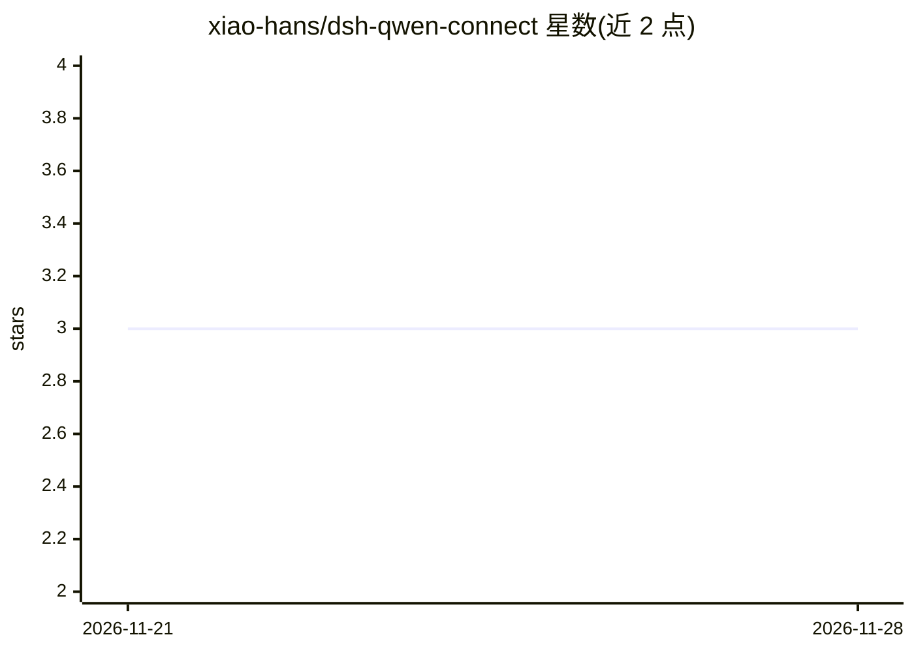

# xiao-hans/dsh-qwen-connect

⭐ 3 · JavaScript · MIT · 推送 2026-11-24 · [GitHub](https://github.com/xiao-hans/dsh-qwen-connect) · [官网](https://gitee.com/han-xiaos-whisper/dsh-qwen-connect) · 个人维护 · 中文 README

**把千问办公桌面登录态接入 DSH 的模型 Provider 插件**

一个 DeepSeek Harness（DSH）插件：复用千问办公（QwenWorkCN）桌面 App 的登录态，将其注册为 DSH 可选的模型 Provider，无需 API Key。支持流式输出、多轮上下文、工具调用协议转换、图片输入链路、token 统计与上游重试；通过官方 WASM 签名模块与环回 shim 访问上游网关。通过 pnpm 安装进 DSH profile，需重启 DSH 加载。限制包括 Windows 凭据绑定当前用户、模型目录静态内置、思考链无法关闭等。

## 筛选速览

| 维度 | 判定 | 备注 |
|---|---|---|
| AI 角色 | `ai-ecosystem` | LLM/agent 周边工具 |
| 许可风险 | `permissive` | MIT |
| 部署形态 | `library` | 以包/库形式分发 |
| 模型依赖 | — | README 未给出锁定关系 |
| 硬件要求 | — | 无带数字的原话,不猜 |
| 安装摩擦 | `low` | 无编译、无系统依赖或容器化 |
| 成熟度 | — | 结构信号不足 |

## 能力要点

- 复用千问办公桌面登录态，无需 API Key
- 支持流式输出、工具调用透传与图片输入链路
- 环回 shim 仅接受 127.0.0.1 请求，凭据与 JWT 脱敏不下发
- 提供请求级流诊断日志与每请求终止记录

## 适用场景

- 在 DSH 中直接使用千问办公账号额度对话
- 为 DSH agent 会话接入支持工具调用的国产模型通道
- 排查流式对话超时、截断与上游故障

## 场景标签

`模型网关` `编码 Agent` · 领域:Agent 开发

## 证据(README 行号)

> L3: 把**千问办公（QwenWorkCN）桌面 App** 的登录态自动接入 DeepSeek Harness ——
> L27: |Provider 注册（模型出现在 DSH 模型选择器，名称含倍率）|✅|
> L31: |**真实对话**（WASM 签名 + SSE 聊天端点）|✅|

## 星数曲线

2026-11-21 3 → 2026-11-28 3（+0）

---
*卡片 v1 · prompt 1.4 · 生成 2026-11-21 · 置信度 high · 依据 README sha `ab26d37eb38e` · [字段定义](../../DATASET.md)*
