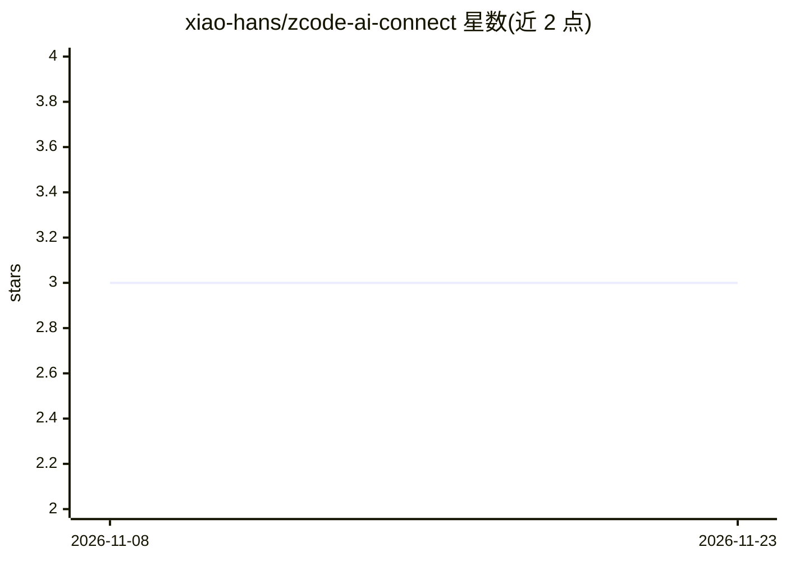

# xiao-hans/zcode-ai-connect

⭐ 3 · JavaScript · MIT · 推送 2026-11-06 · [GitHub](https://github.com/xiao-hans/zcode-ai-connect) · 个人维护 · 中文 README

**把国产 AI IDE 桌面模型以本地 OpenAI 端点接入编码代理**

一组 Node 工具套件，将 Trae CN、WorkBuddy、Qoder CN、千问办公四款桌面 AI IDE 的已登录模型凭据（只读复用）包装为本地 OpenAI 兼容端点，供 ZCode、pi、hermes、Codex、Claude Code 等编码代理调用；不注册自启，宿主启动时经 hook 自动拉起，零 API key、零按量计费。另含 Responses↔chat 与 Anthropic Messages 协议翻译桥、流中断看门狗、工具调用配对修复、停手自动续跑等机制。运行需 Windows 与 Node.js 18+，并要求对应桌面 App 已安装且登录过。

## 筛选速览

| 维度 | 判定 | 备注 |
|---|---|---|
| AI 角色 | `ai-ecosystem` | LLM/agent 周边工具 |
| 许可风险 | `permissive` | MIT |
| 部署形态 | `desktop` | 安装包/桌面程序 |
| 模型依赖 | — | README 未给出锁定关系 |
| 硬件要求 | — | 无带数字的原话,不猜 |
| 安装摩擦 | `low` | 无编译、无系统依赖或容器化 |
| 成熟度 | — | 结构信号不足 |

## 能力要点

- 四款国产 AI IDE 桌面凭据只读复用，暴露为本地 OpenAI 兼容端点
- 提供 Responses API 与 Anthropic Messages 协议的双向翻译桥
- 流中断看门狗、finish_reason 修正与工具调用配对修复
- 模型宣布下一步却停手时的五宿主自动续跑挂载点

## 适用场景

- 在 ZCode/pi/Codex/Claude Code 中使用已登录的国产 IDE 模型而不另购 API
- 为只讲 Responses 或 Anthropic 协议的客户端桥接 chat completions 端点
- 排查长任务中模型提前收尾、流中断等通道问题

## 场景标签

`模型网关` · 领域:Agent 开发

## 证据(README 行号)

> L3: 把四款国产 AI IDE 桌面 App 的模型——**Trae CN**、**WorkBuddy**、**Qoder CN**、**千问办公(QwenWork)**——以本地 OpenAI 兼容端点的形式接入 **ZCode**、*
> L26: 服务**不注册开机自启**。打开 ZCode / pi / hermes **任一应用**时自动拉起:

## 星数曲线

2026-11-08 3 → 2026-11-23 3（+0）

---
*卡片 v1 · prompt 1.4 · 生成 2026-11-21 · 置信度 high · 依据 README sha `78a0e7326b36` · [字段定义](../../DATASET.md)*
