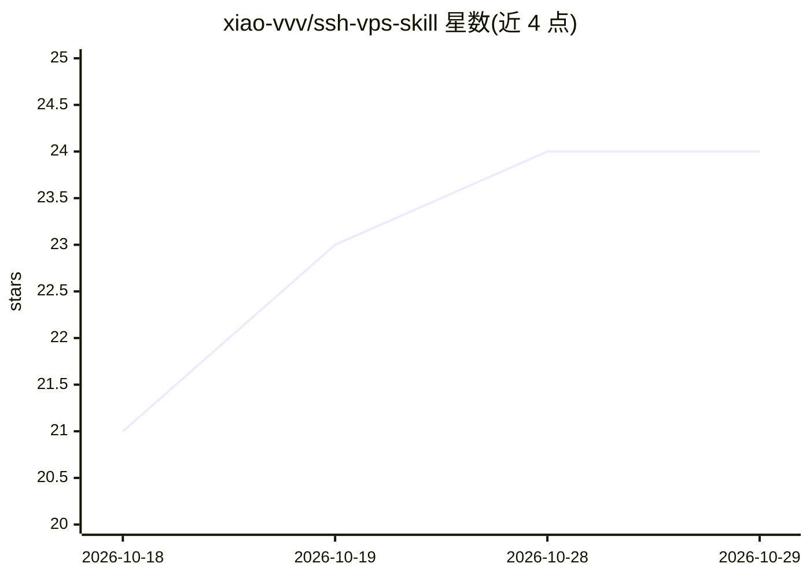

# xiao-vvv/ssh-vps-skill

⭐ 24 · Shell · MIT · 推送 2026-06-23 · [GitHub](https://github.com/xiao-vvv/ssh-vps-skill) · 个人维护 · 中文 README

**给 AI agent 用的 VPS SSH 管理技能：密钥统一、别名管理、批量探活**

面向 Claude Code / openclaw / Codex 等 AI agent 的 VPS SSH 管理技能包，由一份 SKILL.md 与两个 bash 脚本构成，也可脱离 AI 纯手动运行。功能包括：所有机器共用一把 ed25519 密钥、IP/端口/用户名写入 ~/.ssh/vps.config 别本并接入 ~/.ssh/config、密码一次性输入后下发公钥、关闭密码登录前先验证密钥可登录并用 sshd -T 复核、批量查看多台机器在线与系统状态。脚本跑在本地（macOS/Linux），服务器端无需安装，依赖 bash/python3/openssh，下发公钥时需 expect。

## 筛选速览

| 维度 | 判定 | 备注 |
|---|---|---|
| AI 角色 | `ai-enhanced` | 去掉 AI 部分产品仍成立 |
| 许可风险 | `permissive` | MIT |
| 部署形态 | `None` |  |
| 模型依赖 | — | README 未给出锁定关系 |
| 硬件要求 | — | 无带数字的原话,不猜 |
| 安装摩擦 | `low` | 无编译、无系统依赖或容器化 |
| 成熟度 | — | 结构信号不足 |

## 能力要点

- 统一密钥 + 别名管理（写入 ~/.ssh/vps.config 并接入 ~/.ssh/config）
- 关闭密码登录前先验证密钥可登录，并以 sshd -T 复核配置
- 批量探活并查看系统/内核/CPU/内存/磁盘状态
- 别名模糊匹配（输入 tok 匹配 tokyo-1）

## 适用场景

- 拿到新 VPS 后让 AI 一条龙完成加别名、下发公钥、关密码登录
- 让 AI 通过别名批量巡检自己所有服务器的在线与负载状态
- 让 AI 登录服务器排查可疑登录、异常进程与端口占用

## 场景标签

 · 领域:运维/服务器管理

## 证据(README 行号)

> L13: 它就是一个小小的 **skill**：一份 `SKILL.md` 加两个自带的 bash 脚本，丢进你的 AI agent 里，它就学会了怎么帮你把手上的小鸡们都安全、整齐地管起来。跑在你自己电脑上，服务器那头啥都不用装。
> L67: ### 想纯手动用（不配 AI 也没问题）

## 星数曲线

2026-10-18 21 → 2026-10-29 24（+3）

---
*卡片 v1 · prompt 1.4 · 生成 2026-10-27 · 置信度 high · 依据 README sha `94cb5cb8f170` · [字段定义](../../DATASET.md)*
