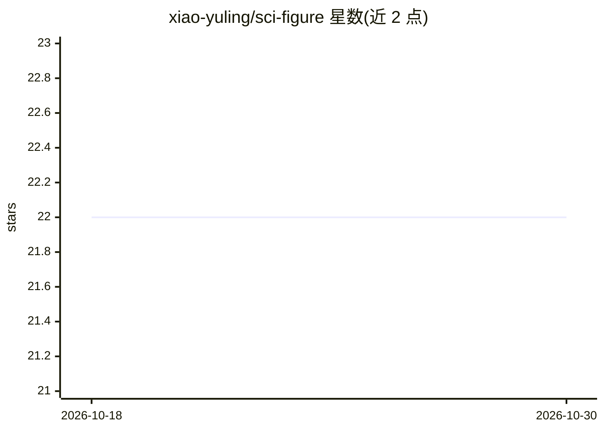

# xiao-yuling/sci-figure

⭐ 22 · MIT · 推送 2026-07-27 · [GitHub](https://github.com/xiao-yuling/sci-figure) · [官网](https://xiao-yuling.github.io/sci-figure) · 个人维护 · 中文 README

**面向 AI agent 的科研绘图 skill，生成 SCI/Elsevier 风格论文图**

以 skill.md 为核心的 AI 技能包，向 AI agent 提供可复用的科研绘图指令、参考规则与 Python/R 示例脚本，用于生成投稿级 SCI 图表。默认样式针对 Elsevier 工程类期刊：Times 系字体、四边框坐标轴、仅左/下外向刻度、紧凑子图标题与克制配色。不绑定任何 AI 平台，可将 skill.md 复制进提示词、agent memory 或工作流模板；附带图类型索引（散点/折线/热图/森林图/多子图等）与可运行示例，导出 SVG/PDF/TIFF。参考 nature-figure 的组织方式但为独立实现。

## 筛选速览

| 维度 | 判定 | 备注 |
|---|---|---|
| AI 角色 | `ai-knowledge` | 知识聚合/清单类 |
| 许可风险 | `permissive` | MIT |
| 部署形态 | `None` |  |
| 模型依赖 | — | README 未给出锁定关系 |
| 硬件要求 | — | 无带数字的原话,不猜 |
| 安装摩擦 | `low` | 无编译、无系统依赖或容器化 |
| 成熟度 | — | 结构信号不足 |

## 能力要点

- skill.md 可复制到任意 agent 提示词/memory/工作流，不绑定平台
- 默认样式面向 Elsevier/SCI 期刊（Times 字体、四边框、外向刻度、克制配色）
- 覆盖散点/折线/热图/森林图/多子图等 8 类图族，提供 Python 与 R 双语言
- 示例脚本输出可编辑 SVG/PDF 与高分辨率 TIFF/PNG

## 适用场景

- 让 AI agent 生成投稿用的期刊风格论文图
- 为科研团队统一绘图规范与可复现脚本
- 多子图结果展示与期刊友好导出

## 场景标签

`科研工具` `提示工程` · 领域:Agent 开发

## 证据(README 行号)

> L5: `sci-figure` is a general-purpose AI skill for scientific figure generation.
> L21: `sci-figure` is not tied to any specific AI platform. Use it as an AI skill by
> L119: `sci-figure` 是一套面向 AI agent 的通用科研绘图 skill，用于生成适合

## 星数曲线

2026-10-18 22 → 2026-10-30 22（+0）

---
*卡片 v1 · prompt 1.4 · 生成 2026-10-27 · 置信度 high · 依据 README sha `a7278d471edd` · [字段定义](../../DATASET.md)*
