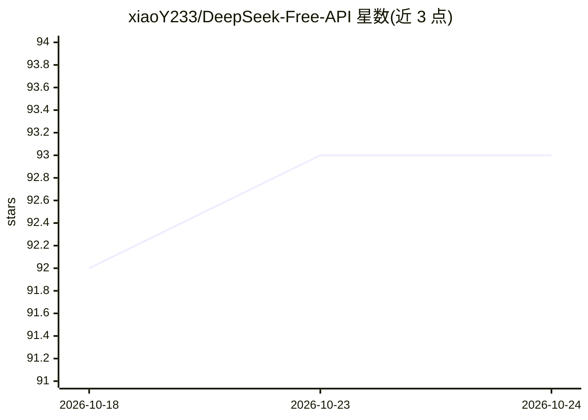

# xiaoY233/DeepSeek-Free-API

⭐ 93 · TypeScript · GPL-3.0 · 推送 2026-02-26 · [GitHub](https://github.com/xiaoY233/DeepSeek-Free-API) · [官网](https://platform.deepseek.com/) · 个人维护 · 中文 README

**DeepSeek 网页端逆向免费 API 服务，供自用测试**

由社区 fork 维护的 DeepSeek 逆向 API 服务：从 DeepSeek 网页端提取 userToken 作为凭证，将对网页端的调用封装为 OpenAI / Gemini / Claude 三种兼容接口（含 /v1/chat/completions、/v1/messages 等），支持流式输出、多轮对话、联网搜索、R1 深度思考与多账号 token 轮换。以 Docker 镜像部署，默认 8000 端口。README 声明逆向 API 不稳定、仅限自用禁止商用，并标注本项目已停止更新，后续由 Chat2API 维护。

## 筛选速览

| 维度 | 判定 | 备注 |
|---|---|---|
| AI 角色 | `ai-ecosystem` | LLM/agent 周边工具 |
| 许可风险 | `viral` | GPL-3.0 |
| 部署形态 | `self-host` | docker 或自建部署 |
| 模型依赖 | locked-api |  |
| 硬件要求 | — | 无带数字的原话,不猜 |
| 安装摩擦 | `low` | 无编译、无系统依赖或容器化 |
| 成熟度 | — | 结构信号不足 |

## 能力要点

- 提供 OpenAI/Gemini/Claude 三种兼容接口
- 支持流式输出、多轮对话、联网搜索、R1 深度思考
- 多账号 userToken 逗号拼接轮换，附 token 存活检测接口
- Docker 零配置部署，8000 端口

## 适用场景

- 测试环境中自用调用 DeepSeek 模型
- 让 openai/gemini-cli/claude-code 等兼容客户端接入
- Dify 等线上服务通过兼容接口接入使用

## 场景标签

 · 领域:LLM 基础设施/API 代理

## 证据(README 行号)

> L150: 1. 与OpenAI兼容的 `/v1/chat/completions` 接口
> L154: 可自行使用与openai、gemini-cli、claude-code或其他兼容的客户端接入接口，或者使用 dify 等线上服务接入使用。

## 星数曲线

2026-10-18 92 → 2026-10-24 93（+1）

---
*卡片 v1 · prompt 1.4 · 生成 2026-10-23 · 置信度 high · 依据 README sha `a55a4ba61d5a` · [字段定义](../../DATASET.md)*
