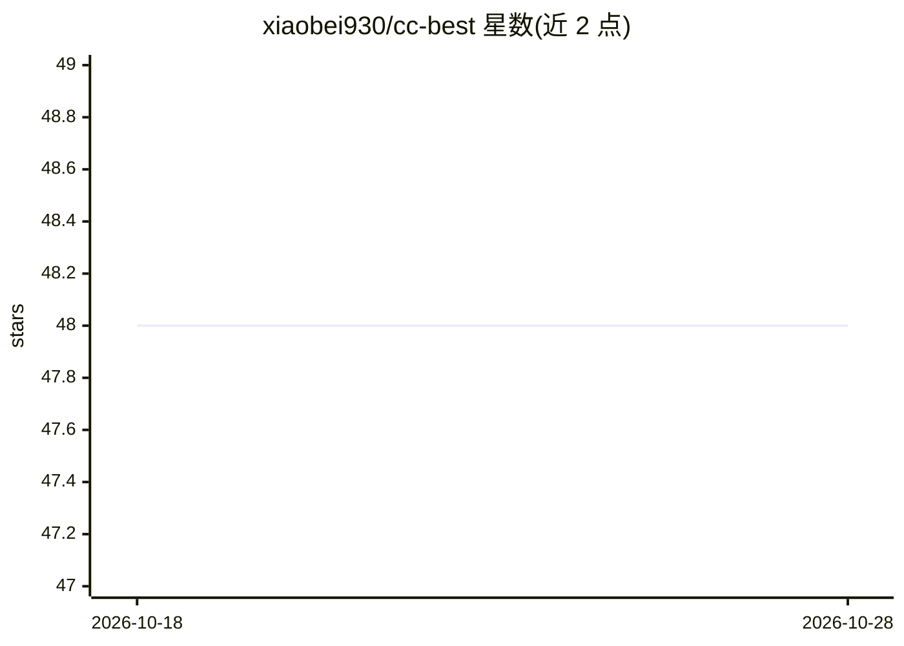

# xiaobei930/cc-best

⭐ 48 · JavaScript · MIT · 推送 2026-06-12 · [GitHub](https://github.com/xiaobei930/cc-best) · [官网](https://xiaobei930.github.io/cc-best/) · 个人维护 · 中文 README

**Claude Code 插件：提供 PM→Lead→Dev→QA 角色化开发工作流**

面向 Claude Code 用户的插件，将单一 AI 编程助手组织为多角色协作流水线：PM 需求分析、Lead 技术设计、Dev 实现、QA 验证的完整开发周期，含 44 个命令、19 个技能、8 个 agent、43 条规则与 30 个 hooks。提供自主迭代模式（/cc-best:iterate 无干预执行至完成）、结对编程模式（5 个强制确认检查点）与安全 hooks（拦截 rm -rf、git push --force 等危险命令）。另含 observe→analyze→learn→evolve 的知识管线，从开发模式中提取可复用知识并生成新命令。支持 Windows/macOS/Linux，可经插件市场或 git clone 安装。

## 筛选速览

| 维度 | 判定 | 备注 |
|---|---|---|
| AI 角色 | `ai-ecosystem` | LLM/agent 周边工具 |
| 许可风险 | `permissive` | MIT |
| 部署形态 | `None` |  |
| 模型依赖 | locked-api |  |
| 硬件要求 | — | 无带数字的原话,不猜 |
| 安装摩擦 | `medium` | 含编译或系统依赖之一 |
| 成熟度 | — | 结构信号不足 |

## 能力要点

- PM→Lead→Designer→Dev→QA 七角色流水线与 REQ→DES→TSK 编号文档链
- /cc-best:iterate 自主迭代：8 种状态条件自动选角色，4 种停止条件
- 安全 hooks 拦截 rm -rf /、git push --force 等危险命令
- observe→analyze→learn→evolve 自演化知识管线
- 跨平台支持（Windows/macOS/Linux），自动检测包管理器

## 适用场景

- 让 Claude Code 按团队角色分工自主完成从需求到提交的开发周期
- 结对模式下逐步学习代码库或执行敏感操作
- 多语言项目（Python/前端/Java/C#/C++ 等）套用分层编码规范

## 场景标签

`编码 Agent` · 领域:编码与开发

## 证据(README 行号)

> L3:  Role-Driven Development Workflow for Claude Code
> L120: |🔄 **Autonomous Mode**|`/cc-best:iterate` runs tasks without intervention until completion|
> L125: |🔗 **Knowledge Pipeline**|observe → analyze → learn → evolve — self-improving knowledge loop|

## 星数曲线

2026-10-18 48 → 2026-10-28 48（+0）

---
*卡片 v1 · prompt 1.4 · 生成 2026-10-25 · 置信度 high · 依据 README sha `e35eacaac322` · [字段定义](../../DATASET.md)*
