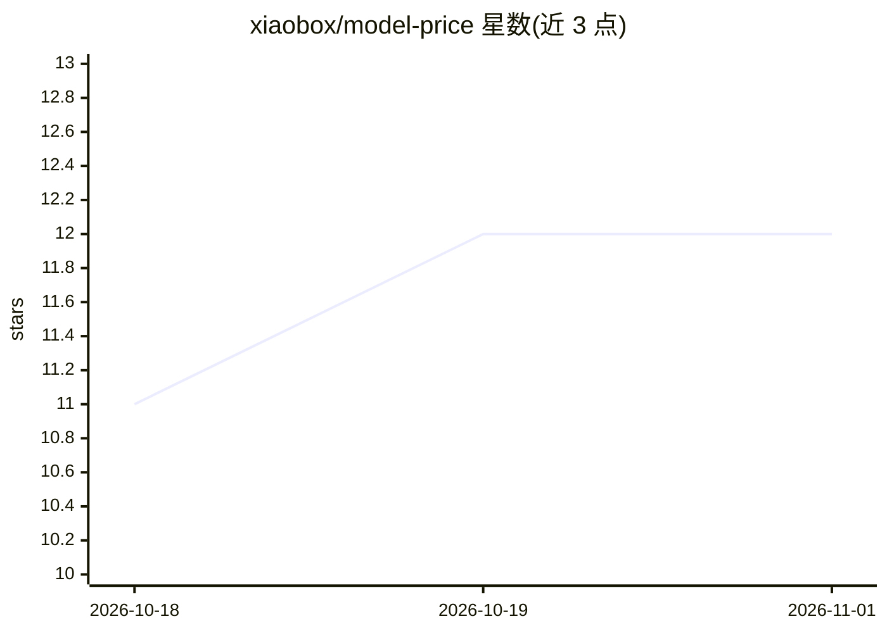

# xiaobox/model-price

⭐ 12 · Python · MIT · 推送 2026-04-29 · [GitHub](https://github.com/xiaobox/model-price) · [官网](https://modelprice.boxtech.icu/) · 个人维护 · 中文 README

**面向开发者的 650+ LLM 价格与能力对比查询站点**

聚合各厂商 LLM 定价数据的 Web 应用：从 LiteLLM 注册表与厂商官方页面抓取数据，统一归一化为每百万 token 单价，以 Entity/Offering 两层数据模型跨厂商去重（同一模型在 Anthropic/Bedrock/OpenRouter 的多个报价归为一实体）。前端提供 ⌘K 模糊搜索、最多 4 模型并排对比、同档更便宜的替代推荐（能力重叠×节省额排序）、可分享 URL 与中英双语；后端为 FastAPI，附带 drift 数据质量报告与 118 个测试。本地开发需分别以 uv 与 npm 运行前后端。

## 筛选速览

| 维度 | 判定 | 备注 |
|---|---|---|
| AI 角色 | `ai-knowledge` | 知识聚合/清单类 |
| 许可风险 | `permissive` | MIT |
| 部署形态 | `library` | 以包/库形式分发 |
| 模型依赖 | — | README 未给出锁定关系 |
| 硬件要求 | — | 无带数字的原话,不猜 |
| 安装摩擦 | `low` | 无编译、无系统依赖或容器化 |
| 成熟度 | — | 结构信号不足 |

## 能力要点

- 650+ 模型定价统一归一化为每百万 token 单价
- Entity/Offering 两层模型跨厂商去重，一实体多报价
- 同档更便宜推荐：Jaccard 能力重叠 × 价格差排序
- 内置 v2-fallback.json 快照，后端冷启动时前端即时渲染

## 适用场景

- 在多个 LLM 厂商报价间做选型对比
- 查找与目标模型能力相近但更便宜的替代
- 获取可分享的模型价格对比链接供团队讨论

## 场景标签

 · 领域:LLM 定价信息/开发者工具

## 证据(README 行号)

> L5: **Compare 650+ LLMs side by side — real pricing, real capabilities.**
> L26: - Knows about **650+ models** across Anthropic, OpenAI, Google, xAI, Meta, DeepSeek, Moonshot AI, Alibaba, Z.AI, Mi
> L28: - Sources data from the community-maintained **LiteLLM registry** + direct provider scrapes — so new models land wi

## 星数曲线

2026-10-18 11 → 2026-11-01 12（+1）

---
*卡片 v1 · prompt 1.4 · 生成 2026-10-31 · 置信度 high · 依据 README sha `56b6b0ebcfac` · [字段定义](../../DATASET.md)*
