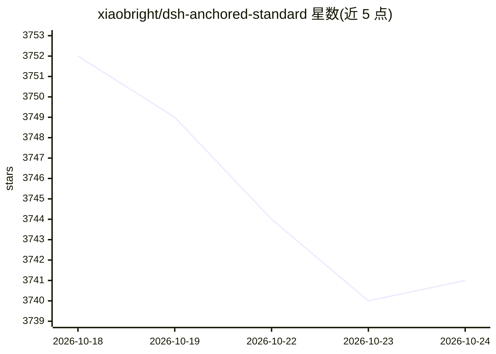

# xiaobright/dsh-anchored-standard

⭐ 3,741 · JavaScript · NOASSERTION · 推送 2026-10-21 · [GitHub](https://github.com/xiaobright/dsh-anchored-standard) · [官网](https://github.com/xiaobright/modeltest) · 个人维护 · 中文 README

**DeepSeek Harness 两阶段锚定预设：先 Minimal 引导再解锁 Standard 工具**

面向 DeepSeek Harness 的社区预设插件集合：会话首个请求仅暴露 Minimal 工具对（bash + str_replace_editor）并抑制所有自动注入上下文以锚定模型推理轨迹，在首个持久 tool/call 或 assistant/message 后晋升到常驻工具目录，重型 Standard 工具经 dev_tool_search 按需解锁。提供 7 种模式（零锚定、whoami、prefab 预制、永恒 Minimal 等）。项目已冻结（2026-09-10）：目标模型 V4 Pro 已退役，不再接受 issue 与 PR。分数 98/99 系作者原始观察，独立复现未定论。

## 筛选速览

| 维度 | 判定 | 备注 |
|---|---|---|
| AI 角色 | `ai-ecosystem` | LLM/agent 周边工具 |
| 许可风险 | `none` | NOASSERTION |
| 部署形态 | `None` |  |
| 模型依赖 | locked-api |  |
| 硬件要求 | — | 无带数字的原话,不猜 |
| 安装摩擦 | `low` | 无编译、无系统依赖或容器化 |
| 成熟度 | — | 结构信号不足 |

## 能力要点

- 两阶段设计：首请求 Minimal 工具对锚定轨迹，晋升后按需解锁重型工具
- context-gate 插件统一抑制 bootstrap 期全部自动注入（AGENTS.md/技能目录等）
- 7 种模式变体：锚定/零锚定/whoami/预制种子/永恒 Minimal 等
- 阶段状态由持久会话事件派生，resume/reload 后保留

## 适用场景

- 在 DeepSeek Harness 上保留 Minimal 轨迹风格同时获得 Standard 工具集
- 研究 API 可见面（工具 schema/输出预算/注入）对模型轨迹的影响
- 复用预制（prefab）种子跳过 bootstrap 阶段直接启动会话

## 场景标签

`Agent 框架` · 领域:Agent 开发

## 证据(README 行号)

> L5: Experimental DeepSeek Harness agent presets — a base mode, two live-anchor
> L72: |Anchored Standard|`preset/`|2 tools (the Minimal pair)|Minimal tool schema|first durable `tool/call` **or** `assis
> L80: Every mode directory is self-contained and installs alone under whatever id

## 星数曲线

2026-10-18 3,752 → 2026-10-24 3,741（-11）

---
*卡片 v1 · prompt 1.4 · 生成 2026-10-20 · 置信度 high · 依据 README sha `a538063a2521` · [字段定义](../../DATASET.md)*
