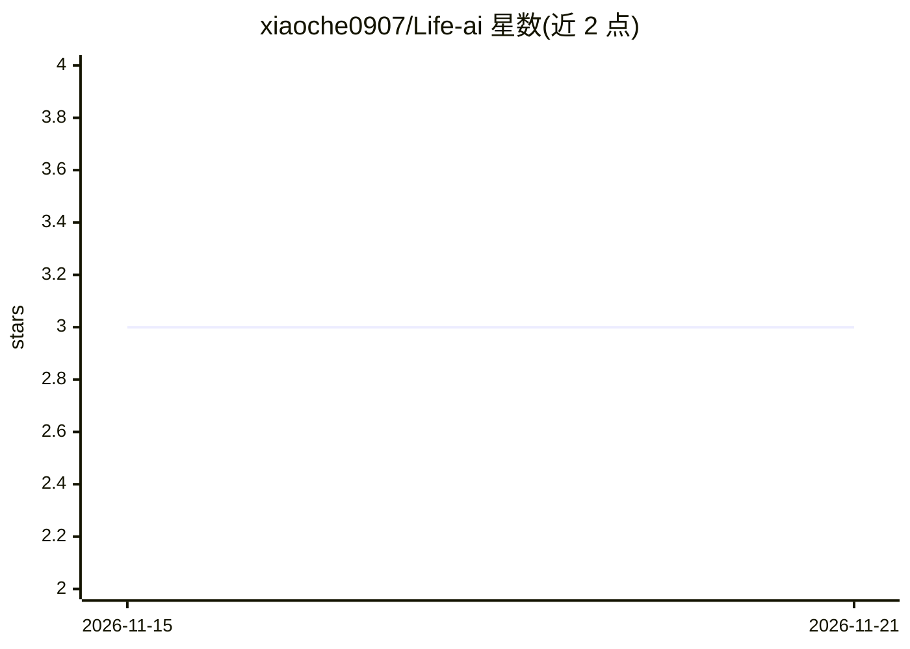

# xiaoche0907/Life-ai

⭐ 3 · JavaScript · 推送 2026-11-20 · [GitHub](https://github.com/xiaoche0907/Life-ai) · [官网](https://github.com/xiaoche0907/Life-ai/releases) · 个人维护 · 中文 README

**面向 Photoshop 的 AI 生图与修图桌面助手（Windows 测试版）**

基于 Electron 的 Windows 桌面应用，围绕 Photoshop 图像创作与修图流程提供独立工具窗口。通过悬浮球控制台组合使用 AI 生图、提示词库、参考图、批处理与图像工具，并经桥接插件调用 Photoshop 的选区与全图输入、结果回传能力。生图需自行配置服务渠道与 API Key，默认 Gemini 协议，可选 OpenAI 图片接口；Forge/ComfyUI 需先启动本地服务并配置连接地址。桥接插件要求 Photoshop 23.3.0 以上。当前为未签名测试版，真实联动流程尚未完成全面验证。

## 筛选速览

| 维度 | 判定 | 备注 |
|---|---|---|
| AI 角色 | `ai-enhanced` | 去掉 AI 部分产品仍成立 |
| 许可风险 | `none` | — |
| 部署形态 | `desktop` | 安装包/桌面程序 |
| 模型依赖 | — | README 未给出锁定关系 |
| 硬件要求 | — | 无带数字的原话,不猜 |
| 安装摩擦 | `low` | 无编译、无系统依赖或容器化 |
| 成熟度 | `idea` | |

## 能力要点

- AI 生图：配置渠道与模型，调整比例、分辨率与生成数量
- 通过桥接插件联动 Photoshop 选区、全图输入与结果回传
- 支持 Forge / ComfyUI 本地服务的预设与工作流
- 批处理、自动修图与打光、校色等图像工具

## 适用场景

- 在 Photoshop 里直接调用 AI 生图并回传结果
- 管理提示词分组词库并用参考图辅助创作
- 用批处理与自动修图处理重复修图任务
- 连接本地 Forge / ComfyUI 服务使用工作流

## 场景标签

`图像生成` · 领域:内容生成

## 证据(README 行号)

> L12: Life-ai（来福）是一款基于 Electron 的 Windows 桌面助手，围绕 Photoshop 图像创作与修图工作流提供独立工具窗口。通过 Life 狗狗悬浮球打开控制台，可以组合使用生图、提示词库、参考图、批处理及图
> L24: |Photoshop 联动|通过桥接调用 Photoshop 能力，配合选区、全图输入及结果回传|
> L25: |Forge / ComfyUI|连接已配置的本地服务，使用预设和工作流|

## 星数曲线

2026-11-15 3 → 2026-11-21 3（+0）

---
*卡片 v1 · prompt 1.4 · 生成 2026-11-21 · 置信度 high · 依据 README sha `0f7173f9d98b` · [字段定义](../../DATASET.md)*
