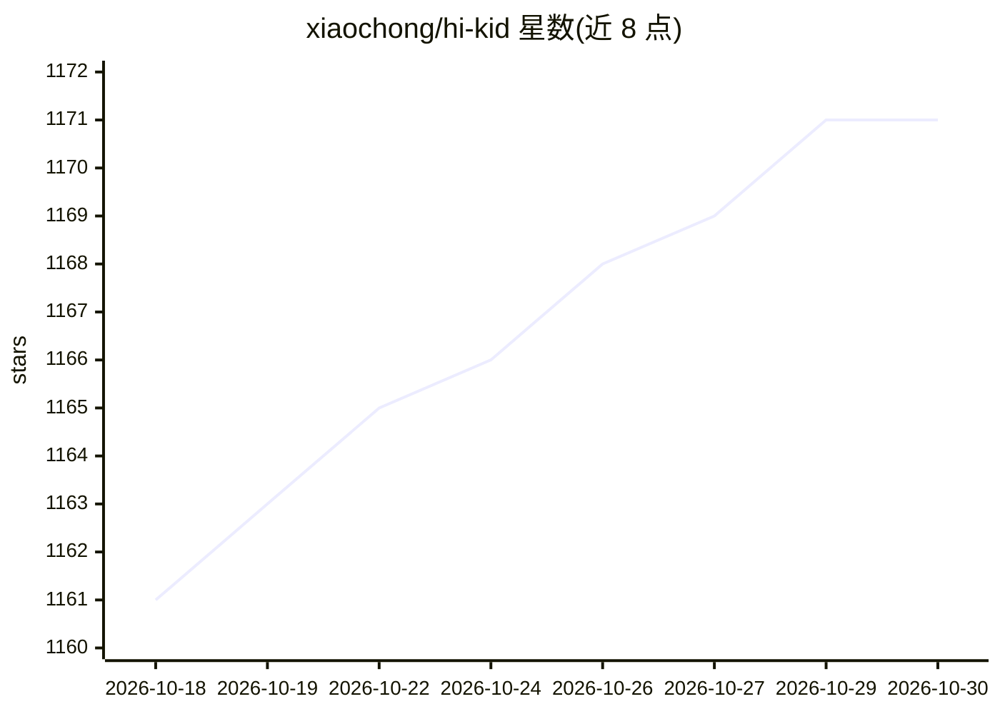

# xiaochong/hi-kid

⭐ 1,171 · TypeScript · MIT · 推送 2026-04-24 · [GitHub](https://github.com/xiaochong/hi-kid) · [官网](https://xiaochong.github.io/hi-kid) · 个人维护 · 中文 README

**面向儿童英语口语练习的离线 AI 语音对话桌面应用**

基于 Electron/React/TypeScript 的免费开源桌面应用，服务非英语国家儿童练习英语听说。用户对麦克风说话，经本地管线完成对话：SoX 录音与 VAD 检测 → asr-server（Qwen3-ASR-0.6B）语音转文本 → Ollama（默认 qwen3:0.6b）生成回复 → kitten-tts-server 本地语音合成播放。所有数据与模型本地运行，无需联网，不上传云端。目前仅支持 macOS 12.0+，需 Node.js >= 20，从源码构建运行；声明仅限学习研究与非商业用途。

## 筛选速览

| 维度 | 判定 | 备注 |
|---|---|---|
| AI 角色 | `ai-native` | 本体是模型或模型工具 |
| 许可风险 | `permissive` | MIT |
| 部署形态 | `library` | 以包/库形式分发 |
| 模型依赖 | local-ok | 支持本地模型 |
| 硬件要求 | — | 无带数字的原话,不猜 |
| 安装摩擦 | `low` | 无编译、无系统依赖或容器化 |
| 成熟度 | — | 结构信号不足 |

## 能力要点

- 全本地语音对话管线（录音/VAD→ASR→LLM→TTS），无需联网
- ASR 基于 Qwen3-ASR-0.6B，LLM 默认 Ollama qwen3:0.6b
- 面向儿童的卡通界面，无打字纯语音交互

## 适用场景

- 非英语国家儿童在家练习英语口语与听力
- 希望孩子练英语但不愿上传语音数据到云端的家长
- 无网络环境下进行英语对话与单词游戏

## 场景标签

`语音 Agent` · 领域:对话与助手

## 证据(README 行号)

> L13: HiKid is a **completely free, forever free** open-source desktop app designed for **kids in non-English-speaking co
> L15: Say "Hello" into the microphone, and it will chat with you in English, tell stories, and play word games — all comp
> L69: User speaks → SoX(rec) recording + VAD detection ──→ ASR server speech-to-text

## 星数曲线

2026-10-18 1,161 → 2026-10-30 1,171（+10）

---
*卡片 v1 · prompt 1.4 · 生成 2026-10-21 · 置信度 high · 依据 README sha `6aec859257d0` · [字段定义](../../DATASET.md)*
