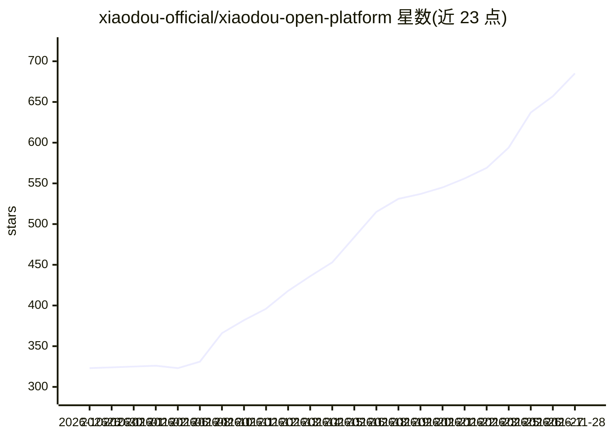

# xiaodou-official/xiaodou-open-platform

⭐ 685 · NOASSERTION · 推送 2026-11-26 · [GitHub](https://github.com/xiaodou-official/xiaodou-open-platform) · [官网](https://xdfair.cn/) · 组织维护 · 中文 README

**个人可申请的支付宝微信聚合收款接口及接入文档**

小豆支付开放平台的接入资料仓库：提供七个 REST 接口（下单、重拉支付、查单、关单、退款、查退款、查到账分配）供个人或企业接入支付宝与微信收款，资金由持牌支付公司清算，平台只提供状态与对账。配套 15 篇文档、Node.js/Java/PHP/Python 四语言签名示例、零依赖本地演示（H5 收银台整链路）以及一份可交给 AI 编码助手的 Agent Skill。兼容易支付/彩虹支付协议插件与 Sub2API、New API 的内置配置，无需改代码即可切换。

## 筛选速览

| 维度 | 判定 | 备注 |
|---|---|---|
| AI 角色 | `ai-enhanced` | 去掉 AI 部分产品仍成立 |
| 许可风险 | `none` | NOASSERTION |
| 部署形态 | `None` |  |
| 模型依赖 | — | README 未给出锁定关系 |
| 硬件要求 | — | 无带数字的原话,不猜 |
| 安装摩擦 | `low` | 无编译、无系统依赖或容器化 |
| 成熟度 | — | 结构信号不足 |

## 能力要点

- 七个接口覆盖下单到退款，含沙箱模拟支付端点
- 请求/响应/webhook 三套 RSA2 签名，四语言示例带对照值
- 兼容易支付/彩虹支付协议及 Sub2API、New API 内置配置
- 附零依赖本地演示与可直接交给编码助手的 Skill 包

## 适用场景

- 个人开发者网站想接支付宝/微信收款而没有营业执照
- 已有发卡或发货系统，只缺收款与支付状态确认这一环
- 系统里已装易支付类插件，不改代码切换收款通道
- 本地断网跑通下单到退款整条链路做接入演练

## 场景标签

 · 领域:支付/电商基础设施

## 证据(README 行号)

> L19: 这套接口就是干这个的：帮你把**支付宝和微信**收进来，告诉你「钱到没到」，再把钱结给你。下单、查单、关单、退款，外加一个只读的「查到账账号与收款分配」——一共七个接口。
> L29: 这个仓库就是它的**全部接入资料**：15 篇文档、四种语言的签名示例、一个能跑起来的本地演示，还有一份可以直接丢给 AI 编码助手（Claude Code、Codex 之类）的 Skill。**跟你在商家后台看到的是同一份内容。
> L41: - **一份 AI Agent Skill**（`skill/`）—— 丢给编码助手就能照着接，和后台下载的那份一模一样。

## 星数曲线

2026-10-26 323 → 2026-11-28 685（+362）

---
*卡片 v1 · prompt 1.4 · 生成 2026-11-26 · 置信度 high · 依据 README sha `450d5808bfa5` · [字段定义](../../DATASET.md)*
