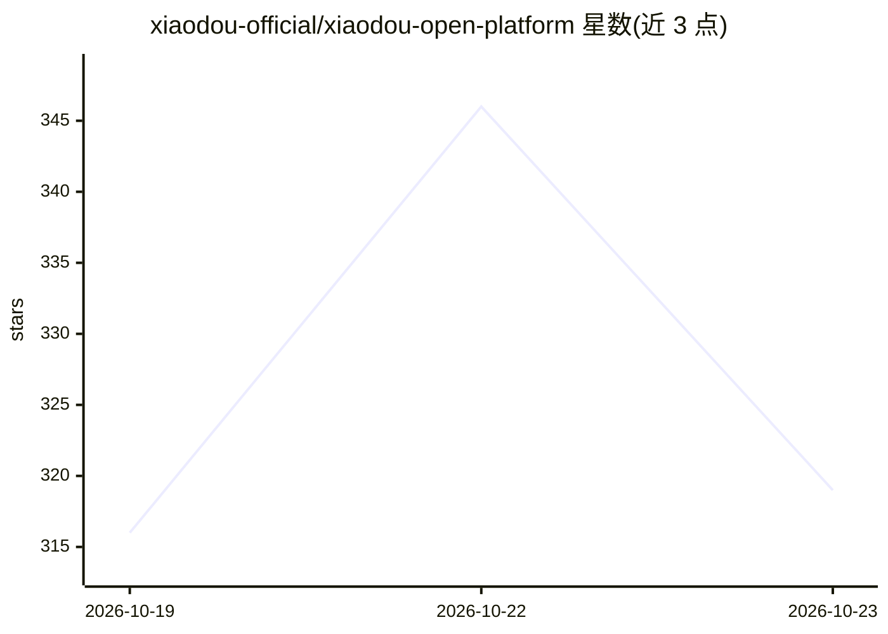

# xiaodou-official/xiaodou-open-platform

⭐ 319 · NOASSERTION · 推送 2026-10-22 · [GitHub](https://github.com/xiaodou-official/xiaodou-open-platform) · [官网](https://xdfair.cn/) · 组织维护 · 中文 README

**支付宝+微信聚合支付接口接入资料，面向个人开发者与个人网站**

小豆支付开放平台的官方接入资料仓库：提供支付宝与微信两条收款通道的七个接口（建单、重拉、查单、关单、退款、查退款、查到账账号），配套 14 篇文档、Node.js/Java/PHP/Python 四语言签名示例、零依赖本地演示及一份可交给 AI 编码助手的 Skill 包。面向个人开发者、个人网站及个体工商户/企业商户，个人主体凭身份证与本人银行卡即可入驻；资金由持牌支付机构清算，另提供易支付/彩虹支付协议兼容接入面。注意仓库是接入资料而非官方 SDK，无沙箱环境。

## 筛选速览

| 维度 | 判定 | 备注 |
|---|---|---|
| AI 角色 | `ai-enhanced` | 去掉 AI 部分产品仍成立 |
| 许可风险 | `none` | NOASSERTION |
| 部署形态 | `None` |  |
| 模型依赖 | — | README 未给出锁定关系 |
| 硬件要求 | — | 无带数字的原话,不猜 |
| 安装摩擦 | `low` | 无编译、无系统依赖或容器化 |
| 成熟度 | — | 结构信号不足 |

## 能力要点

- 七个 REST 接口覆盖下单、查单、退款与结算分配查询
- 三套签名体系（请求/响应/通知）附四语言签名示例与对照值
- 易支付/彩虹支付协议兼容（submit.php/mapi.php/api.php），已有插件无需改代码
- 零依赖本地演示可断网跑通完整收款链

## 适用场景

- 我的个人网站只有卖卡密/虚拟商品的收款需求，直接接这套接口收支付宝和微信
- 我的系统已装易支付插件，只换网关地址、商家 ID 和密钥三格即可切换资金链路
- 作为没有营业执照的个人开发者，完成进件后接入支付 API

## 场景标签

 · 领域:支付/金融科技

## 证据(README 行号)

> L1: # 小豆支付开放平台 · 个人支付接口与虚拟发卡 / 数字商品接入资料（支付宝 + 微信聚合收款 · 持牌机构清算）
> L19: 这套接口就是干这个的：帮你把**支付宝和微信**收进来，告诉你「钱到没到」，再把钱结给你。下单、查单、关单、退款，外加一个只读的「查到账账号与收款分配」——一共七个接口。
> L27: 这个仓库就是它的**全部接入资料**：14 篇文档、四种语言的签名示例、一个能跑起来的本地演示，还有一份可以直接丢给 AI 编码助手（Claude Code、Codex 之类）的 Skill。**跟你在商家后台看到的是同一份内容。

## 星数曲线

2026-10-19 316 → 2026-10-23 319（+3）

---
*卡片 v1 · prompt 1.4 · 生成 2026-10-21 · 置信度 high · 依据 README sha `674f1fcc9a57` · [字段定义](../../DATASET.md)*
