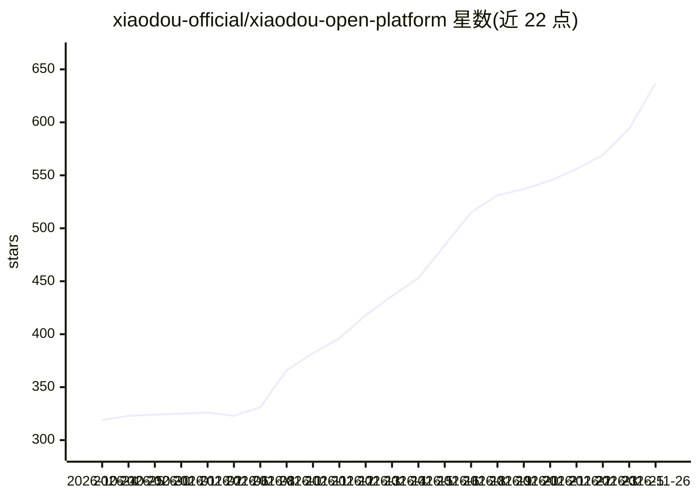

# xiaodou-official/xiaodou-open-platform

⭐ 637 · NOASSERTION · 推送 2026-11-24 · [GitHub](https://github.com/xiaodou-official/xiaodou-open-platform) · [官网](https://xdfair.cn/) · 组织维护 · 中文 README

**个人可申请的支付宝+微信聚合收款接口接入资料库**

小豆支付开放平台的全部接入资料仓：15 篇文档、Node.js/Java/PHP/Python 四语言签名示例、可本地运行的零依赖演示，以及一份供编码助手使用的 Skill。核心是七个支付接口（下单、重拉、查单、关单、退款、查退款、查到账账号），支持 RSA2 三套签名与 webhook 验签，兼容易支付/彩虹支付协议插件，并适配 Sub2API 与 New API。面向无营业执照的个人开发者与已有发货系统的商家，钱由持牌支付公司收付结算。

## 筛选速览

| 维度 | 判定 | 备注 |
|---|---|---|
| AI 角色 | `ai-enhanced` | 去掉 AI 部分产品仍成立 |
| 许可风险 | `none` | NOASSERTION |
| 部署形态 | `None` |  |
| 模型依赖 | — | README 未给出锁定关系 |
| 硬件要求 | — | 无带数字的原话,不猜 |
| 安装摩擦 | `low` | 无编译、无系统依赖或容器化 |
| 成熟度 | — | 结构信号不足 |

## 能力要点

- 七个支付接口与易支付/彩虹支付协议兼容接入面（submit.php/mapi.php/api.php）
- Node.js/Java/PHP/Python 四语言签名示例，带可自跑的对照值
- 零依赖本地演示（demo/h5-cashier）可跑通下单到退款整条链
- 提供可交给 AI 编码助手的 Skill 包与 15 篇在线文档

## 适用场景

- 个人开发者给网站接入支付宝/微信收款而无需营业执照
- 已有易支付/彩虹支付插件的系统不改代码切换收款通道
- 卖虚拟卡密类数字商品的系统补上收款一环
- 先在本地断网演示跑通支付流程再接入

## 场景标签

 · 领域:支付/金融基础设施

## 证据(README 行号)

> L1: # 小豆支付开放平台 · 个人支付接口与虚拟发卡 / 数字商品接入资料（支付宝 + 微信聚合收款 · 持牌机构清算）
> L19: 这套接口就是干这个的：帮你把**支付宝和微信**收进来，告诉你「钱到没到」，再把钱结给你。下单、查单、关单、退款，外加一个只读的「查到账账号与收款分配」——一共七个接口。
> L29: 这个仓库就是它的**全部接入资料**：15 篇文档、四种语言的签名示例、一个能跑起来的本地演示，还有一份可以直接丢给 AI 编码助手（Claude Code、Codex 之类）的 Skill。**跟你在商家后台看到的是同一份内容。

## 星数曲线

2026-10-24 319 → 2026-11-26 637（+318）

---
*卡片 v1 · prompt 1.4 · 生成 2026-11-25 · 置信度 high · 依据 README sha `5a740298908a` · [字段定义](../../DATASET.md)*
