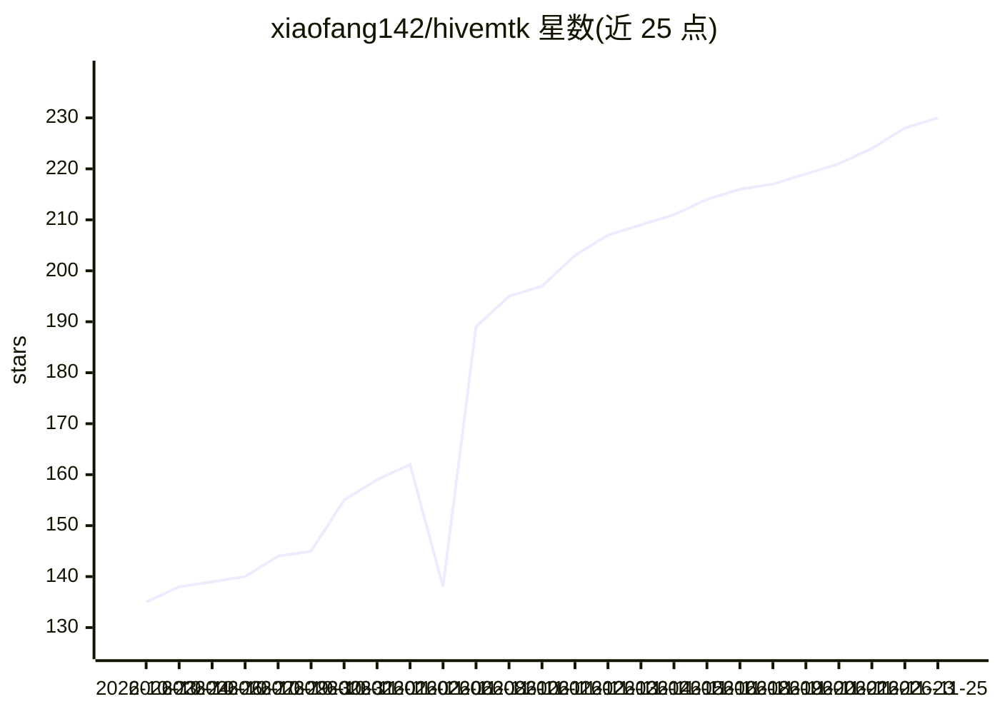

# xiaofang142/hivemtk

⭐ 230 · Go · AGPL-3.0 · 推送 2026-11-23 · [GitHub](https://github.com/xiaofang142/hivemtk) · [官网](https://xapptool.cn/) · 组织维护 · 中文 README

**面向私域运营团队的开源 AI 营销 SCRM 系统，支持自托管**

以 Go + Vue 3 构建的私域营销系统，包含四条主线：经 Chrome 扩展桥接或官方 API 连接抖音/小红书/企微/WhatsApp/Telegram 等 10+ 渠道的统一收件箱；45 个原子工具组成的 ReAct 自主智能体；基于 pgvector + bge-m3/bge-reranker 的知识库 RAG；以 llama.cpp(Qwen2.5)+TEI 组成的本地推理栈实现数据不出内网。另含 GEO 模块与营销画布。README 按

## 筛选速览

| 维度 | 判定 | 备注 |
|---|---|---|
| AI 角色 | `ai-native` | 本体是模型或模型工具 |
| 许可风险 | `viral` | AGPL-3.0 |
| 部署形态 | `self-host` | docker 或自建部署 |
| 模型依赖 | — | README 未给出锁定关系 |
| 硬件要求 | — | 无带数字的原话,不猜 |
| 安装摩擦 | `low` | 无编译、无系统依赖或容器化 |
| 成熟度 | — | 结构信号不足 |

## 能力要点

- 10+ 渠道统一收件箱，渠道支持分正式/实验性/未交付三级口径披露
- ReAct 自主智能体：45 个原子工具，感知→规划→调工具→反思循环
- 本地推理栈 llama.cpp(Qwen2.5)+TEI，对话/向量化的全内网完成
- GEO 模块：多厂商 LLM 模拟 AI 搜索作答量化品牌提及

## 适用场景

- 私域获客：AI 智能体自动承接咨询、处理异议、邀约逼单
- 企微多账号聚合与客户资产沉淀、离职继承
- 金融/医疗/政企等合规行业的私有化部署客服与营销
- 跨境出海多渠道（TikTok/WhatsApp/Telegram）统一管理

## 场景标签

`RAG` `聊天机器人` · 领域:对话与助手

## 证据(README 行号)

> L31: **HiveMtk**("Hive"+"Marketing Toolkit")是一套**面向中文私域运营场景的开源 AI 营销系统**,把四件事在同一个仓库里做透:
> L34: 2. **ReAct 自主智能体** —— 感知 → 规划 → 调工具 → 反思,45 个原子工具自主组合,不是写死的 if-else 工作流
> L89: - **本地推理栈**:llama.cpp(Qwen2.5)+ TEI(bge-m3 + bge-reranker-v2-m3),LLM/Embedding/Rerank 三个 OpenAI 兼容服务跑在客户内网

## 星数曲线

2026-10-23 135 → 2026-11-25 230（+95）

---
*卡片 v1 · prompt 1.4 · 生成 2026-11-25 · 置信度 high · 依据 README sha `64e3120f297b` · [字段定义](../../DATASET.md)*
