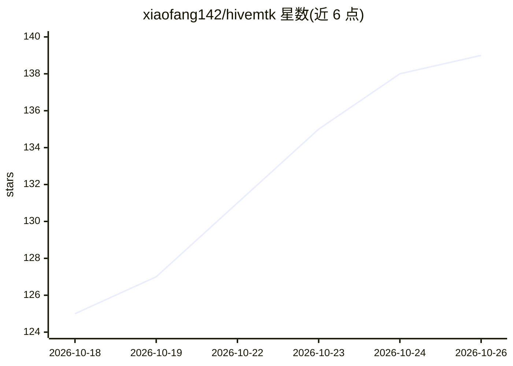

# xiaofang142/hivemtk

⭐ 139 · Go · AGPL-3.0 · 推送 2026-10-25 · [GitHub](https://github.com/xiaofang142/hivemtk) · [官网](https://xapptool.cn/) · 组织维护 · 中文 README

**中文私域运营团队的开源 AI 营销 SCRM 系统**

面向中文私域营销场景的自托管 SCRM 系统（Go + Vue 3 + PostgreSQL/pgvector + Docker Compose，AGPL-3.0）：聚合抖音/小红书/快手/微信/企微/WhatsApp/TikTok/Telegram 等 10+ 渠道到统一收件箱与 CDP 客户视图；AI 部分包括 ReAct 智能体（45 个原子工具、四层记忆）、pgvector+BM25 混合检索 RAG、GEO 生成式引擎优化模块。默认本地推理栈（llama.cpp Qwen2.5 + TEI），数据不出内网，也可切云端 LLM。目标用户为 5-50 人成长型团队与合规敏感行业。

## 筛选速览

| 维度 | 判定 | 备注 |
|---|---|---|
| AI 角色 | `ai-enhanced` | 去掉 AI 部分产品仍成立 |
| 许可风险 | `viral` | AGPL-3.0 |
| 部署形态 | `self-host` | docker 或自建部署 |
| 模型依赖 | — | README 未给出锁定关系 |
| 硬件要求 | — | 无带数字的原话,不猜 |
| 安装摩擦 | `low` | 无编译、无系统依赖或容器化 |
| 成熟度 | — | 结构信号不足 |

## 能力要点

- 10+ 渠道聚合触达与统一收件箱/CDP 客户视图
- ReAct 智能体：45 个原子工具 + 四层记忆系统 + 可视化 SOP 编排
- 本地推理栈（llama.cpp Qwen2.5 + TEI bge-m3/bge-reranker），数据零出域
- GEO 模块：内容创作 + 多模型验证 AI 搜索品牌提及

## 适用场景

- 私域获客后由 AI 智能体自动承接咨询与谈单
- 多账号多渠道社媒消息统一管理与客户沉淀
- 合规敏感行业（金融/医疗/政企）私有化部署 AI 客服与 RAG 知识库
- 通过 GEO 模块做生成式搜索的品牌内容优化

## 场景标签

`RAG` `聊天机器人` · 领域:对话与助手

## 证据(README 行号)

> L31: **HiveMtk**("Hive"+"Marketing Toolkit")是一套**面向中文私域运营场景的开源 AI 营销系统**,把四件事在同一个仓库里做透:
> L38: 覆盖**获客 → 触达 → 转化 → 复购**全链路。不是"给大模型套个壳",是直接能跑营销业务的完整系统;另附 GEO 模块打通 AI 搜索获客闭环。完整功能列表与已知限制如实披露,见 docs/marketing-featur

## 星数曲线

2026-10-18 125 → 2026-10-26 139（+14）

---
*卡片 v1 · prompt 1.4 · 生成 2026-10-22 · 置信度 high · 依据 README sha `e76c8a9dca35` · [字段定义](../../DATASET.md)*
