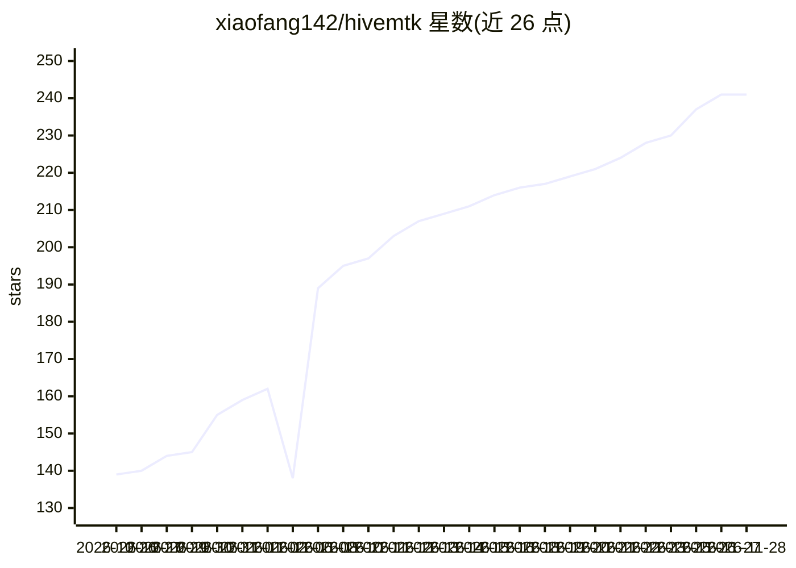

# xiaofang142/hivemtk

⭐ 241 · Go · AGPL-3.0 · 推送 2026-11-27 · [GitHub](https://github.com/xiaofang142/hivemtk) · [官网](https://xapptool.cn/) · 组织维护 · 中文 README

**给私域运营团队的多渠道 AI 营销 SCRM 系统**

面向中文私域运营场景的开源营销系统，将多端社媒触达（抖音/小红书/企微/Telegram/WhatsApp 等经 Chrome 扩展桥接或协议直连）、ReAct 自主智能体（45 个原子工具）、pgvector+bge-m3 本地知识库 RAG 与客户 CDP 视图集成在同一仓库，覆盖获客到复购链路。数据路径主打本地推理栈（llama.cpp Qwen2.5 + TEI），对话与向量化可在内网完成，也支持将 LLM 指向云端 API。Docker Compose 部署，AGPL-3.0 许可，SaaS 修改需开源。

## 筛选速览

| 维度 | 判定 | 备注 |
|---|---|---|
| AI 角色 | `ai-native` | 本体是模型或模型工具 |
| 许可风险 | `viral` | AGPL-3.0 |
| 部署形态 | `self-host` | docker 或自建部署 |
| 模型依赖 | locked-api |  |
| 硬件要求 | — | 无带数字的原话,不猜 |
| 安装摩擦 | `low` | 无编译、无系统依赖或容器化 |
| 成熟度 | — | 结构信号不足 |

## 能力要点

- 10+ 渠道统一收件箱，渠道支持分正式/实验性/未交付三级标注
- ReAct 循环智能体，45 个原子工具自主组合并带五层装饰器
- pgvector HNSW+BM25 RRF 混合检索，bge-reranker 精排
- 本地推理栈零外网可跑，FRP 私域穿透

## 适用场景

- 多渠道私信统一接入并由 AI 客服自动回复
- 企微多账号 SCRM 管理与客户资产沉淀
- 合规行业的私有化部署营销自动化
- 跨境出海品牌管理 TikTok/WhatsApp/Telegram 触达

## 场景标签

`RAG` `聊天机器人` `工作流自动化` · 领域:效率与自动化

## 证据(README 行号)

> L31: **HiveMtk**("Hive"+"Marketing Toolkit")是一套**面向中文私域运营场景的开源 AI 营销系统**,把四件事在同一个仓库里做透:
> L34: 2. **ReAct 自主智能体** —— 感知 → 规划 → 调工具 → 反思,45 个原子工具自主组合,不是写死的 if-else 工作流
> L40: **适合谁**:5–50 人的成长型团队 · 合规敏感行业(金融/医疗/政企)· 不想被 SaaS 厂商锁定的运营团队。

## 星数曲线

2026-10-26 139 → 2026-11-28 241（+102）

---
*卡片 v1 · prompt 1.4 · 生成 2026-11-28 · 置信度 high · 依据 README sha `d6e6b285c04a` · [字段定义](../../DATASET.md)*
