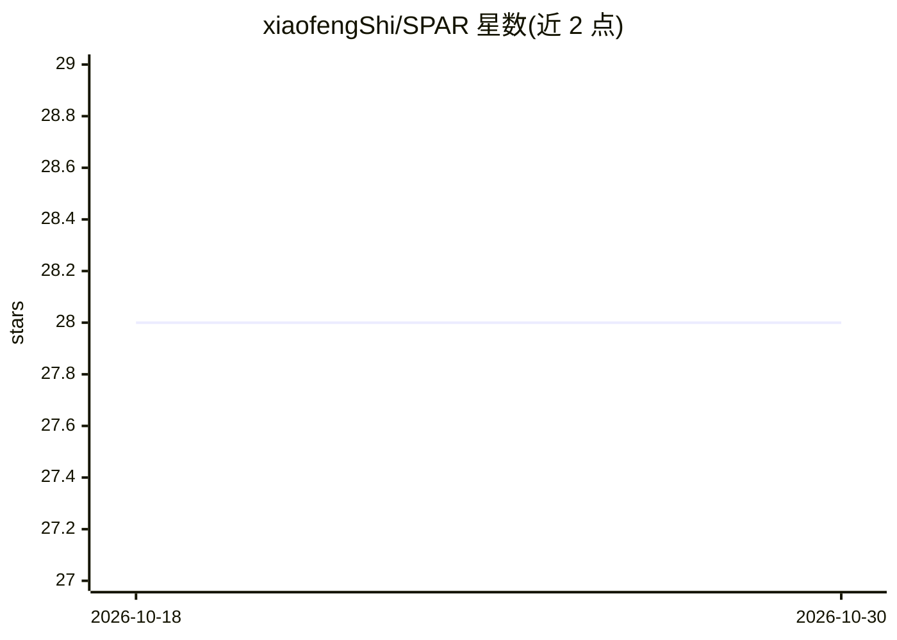

# xiaofengShi/SPAR

⭐ 28 · Python · MIT · 推送 2026-08-25 · [GitHub](https://github.com/xiaofengShi/SPAR) · [官网](https://arxiv.org/abs/2507.15245) · 个人维护 · 中文 README

**面向学术检索的多智能体 LLM 框架：查询分解与引文感知搜索**

SPAR 是基于 LLM 多智能体的学术论文检索框架，组合 RefChain 式查询分解、查询演化、引文感知探索与多轮重排序，提供网页界面与命令行服务接口两种使用方式，可接入 ArXiv、OpenAlex、PubMed 等来源。附带 SPARBench 专家标注数据集用于评测。通过环境变量配置 OpenAI 与 Serper 等 API key，也可经 local_request_v2.py 配置本地模型；可选下载 403 MB 的 arXiv 元数据缓存（解压后 2.16 GB SQLite）加速检索，无缓存时回退到实时学术 API。

## 筛选速览

| 维度 | 判定 | 备注 |
|---|---|---|
| AI 角色 | `ai-native` | 本体是模型或模型工具 |
| 许可风险 | `permissive` | MIT |
| 部署形态 | `library` | 以包/库形式分发 |
| 模型依赖 | — | README 未给出锁定关系 |
| 硬件要求 | — | 无带数字的原话,不猜 |
| 安装摩擦 | `low` | 无编译、无系统依赖或容器化 |
| 成熟度 | — | 结构信号不足 |

## 能力要点

- 查询分解、查询演化、引文网络追踪与多层重排序的检索管线
- SPARBench 专家标注相关性评测数据集
- 可选本地 SQLite 缓存（112,581 条记录）加速检索
- 支持本地模型配置以降低 API 成本

## 适用场景

- 用多智能体检索管线查找并重排相关学术论文
- 在网页界面中交互式执行学术搜索并导出 JSON 结果
- 用 SPARBench 数据集评测学术检索效果

## 场景标签

`多智能体` `科研工具` `模型评测` · 领域:Agent 开发

## 证据(README 行号)

> L11: SPAR is a multi-agent scholarly retrieval framework that combines RefChain-based
> L12: query decomposition, query evolution, citation-aware exploration, and
> L13: re-ranking. The accompanying **SPARBench** dataset provides expert-annotated

## 星数曲线

2026-10-18 28 → 2026-10-30 28（+0）

---
*卡片 v1 · prompt 1.4 · 生成 2026-10-26 · 置信度 high · 依据 README sha `acd96f748b92` · [字段定义](../../DATASET.md)*
