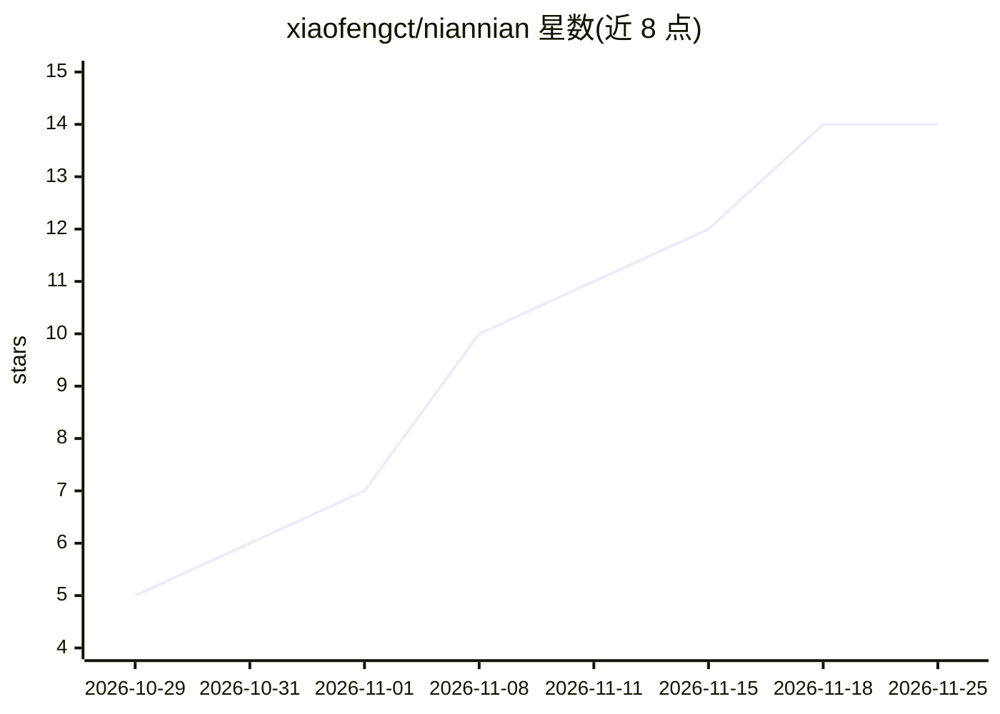

# xiaofengct/niannian

⭐ 14 · HTML · NOASSERTION · 推送 2026-11-15 · [GitHub](https://github.com/xiaofengct/niannian) · [官网](https://xiaofengct.github.io/niannian/) · 个人维护 · 中文 README

**安卓 AI 聊天 App「念念」的更新源与分发仓库**

本仓库不是源码仓库，只分发三样东西：Releases 安装包（仅 arm64-v8a APK）、使用说明链接、40 张可导入的 chara_card_v2 角色卡（其中 30 张原创可自由分发）。App 本体是单人开发的 AI 聊天软件，聊天记录等数据存储在用户本地设备；更新机制为手动触发，读取仓库 version.json 比对 versionCode，下载时校验 sizeBytes、sha256 与包名。软件非开源，禁止商业使用与二次分发，系统要求 Android 7.0 及以上。

## 筛选速览

| 维度 | 判定 | 备注 |
|---|---|---|
| AI 角色 | `ai-native` | 本体是模型或模型工具 |
| 许可风险 | `none` | NOASSERTION |
| 部署形态 | `None` |  |
| 模型依赖 | — | README 未给出锁定关系 |
| 硬件要求 | — | 无带数字的原话,不猜 |
| 安装摩擦 | `low` | 无编译、无系统依赖或容器化 |
| 成熟度 | — | 结构信号不足 |

## 能力要点

- 仓库仅分发 APK、使用说明与 40 张角色卡，源码不公开
- 更新流程校验 sizeBytes、sha256 与包名，不自动后台检查
- 聊天记录、人设、附件全部存储在本地设备
- 仅提供 arm64-v8a 一个架构，刻意不提供 x86_64

## 适用场景

- 下载并安装念念 App 的最新 APK
- 获取恋爱/仙侠/科幻等多题材的 AI 聊天角色卡
- 了解 App 的更新机制与授权条款

## 场景标签

`聊天机器人` · 领域:对话与助手

## 证据(README 行号)

> L3: > 一个 AI 聊天软件，可以让你的前任永远留在你的手机。
> L9: **源码不在本仓库。**

## 星数曲线

2026-10-29 5 → 2026-11-25 14（+9）

---
*卡片 v1 · prompt 1.4 · 生成 2026-11-18 · 置信度 high · 依据 README sha `41ccff9fe85a` · [字段定义](../../DATASET.md)*
