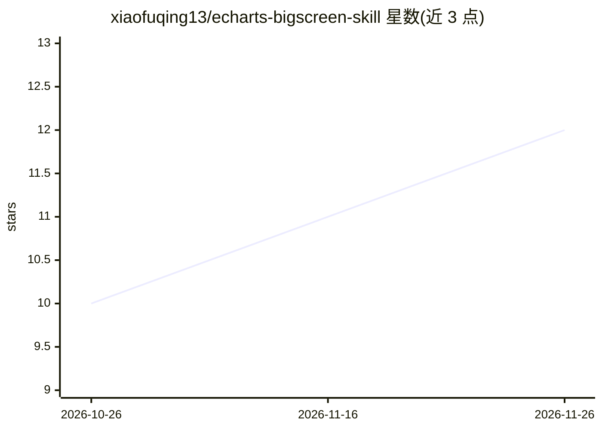

# xiaofuqing13/echarts-bigscreen-skill

⭐ 12 · MIT · 推送 2026-07-12 · [GitHub](https://github.com/xiaofuqing13/echarts-bigscreen-skill) · 个人维护 · 中文 README

**给 AI 编程工具装的大屏技能：一句话生成 ECharts 大屏**

以 Markdown 技能规范（SKILL.md + references）形式存在的技能包，安装到 Claude Code 技能目录或放入 Cursor/Codex 等项目后，AI 按其中规范生成单文件 HTML 大屏。内置 6 套主题配色、4 种布局模式、7 类 ECharts 图表配方、1920×1080 等比缩放方案，并收录中国网络环境与政务内网离线部署的实践规范（国内 CDN 源、本地化 echarts.min.js、file:// CORS 规避、老旧浏览器语法清单）。产物为双击即用的 .html，数据对接需手动替换 MOCK 区的 fetch 接口。

## 筛选速览

| 维度 | 判定 | 备注 |
|---|---|---|
| AI 角色 | `ai-knowledge` | 知识聚合/清单类 |
| 许可风险 | `permissive` | MIT |
| 部署形态 | `None` |  |
| 模型依赖 | — | README 未给出锁定关系 |
| 硬件要求 | — | 无带数字的原话,不猜 |
| 安装摩擦 | `low` | 无编译、无系统依赖或容器化 |
| 成熟度 | — | 结构信号不足 |

## 能力要点

- 6 套主题 + 4 种布局 + 7 类 ECharts 图表成品配方
- 1920×1080 等比缩放，适配 4K/LED 拼接屏并支持自定义物理分辨率
- 政务内网离线部署方案：本地化 echarts 与 GeoJSON、CDN 自动 fallback
- 技能本体为纯 Markdown，任何能读文件的 AI 编程工具可用

## 适用场景

- 给领导快速生成交通/政务/工厂监控类数据大屏
- 政务或公安内网离线环境部署可视化大屏
- 让 AI 编程工具按统一规范产出风格一致的大屏页面

## 场景标签

`提示工程` `数据分析` · 领域:Agent 开发

## 证据(README 行号)

> L15: 给 Claude Code / Codex / Cursor 等 AI 编程工具装上的一个**大屏专业技能**。装好之后,对 AI 说:
> L62: ├── SKILL.md                      # 技能入口(AI 读这个)
> L38: **Cursor / Codex / Windsurf 等其他工具:** 把本仓库文件夹放进项目,在对话里说"按照 echarts-bigscreen-skill/SKILL.md 的规范,给我做一个 ×× 大屏"。技能本体是纯 

## 星数曲线

2026-10-26 10 → 2026-11-26 12（+2）

---
*卡片 v1 · prompt 1.4 · 生成 2026-11-18 · 置信度 high · 依据 README sha `e1fc74e1dc3e` · [字段定义](../../DATASET.md)*
