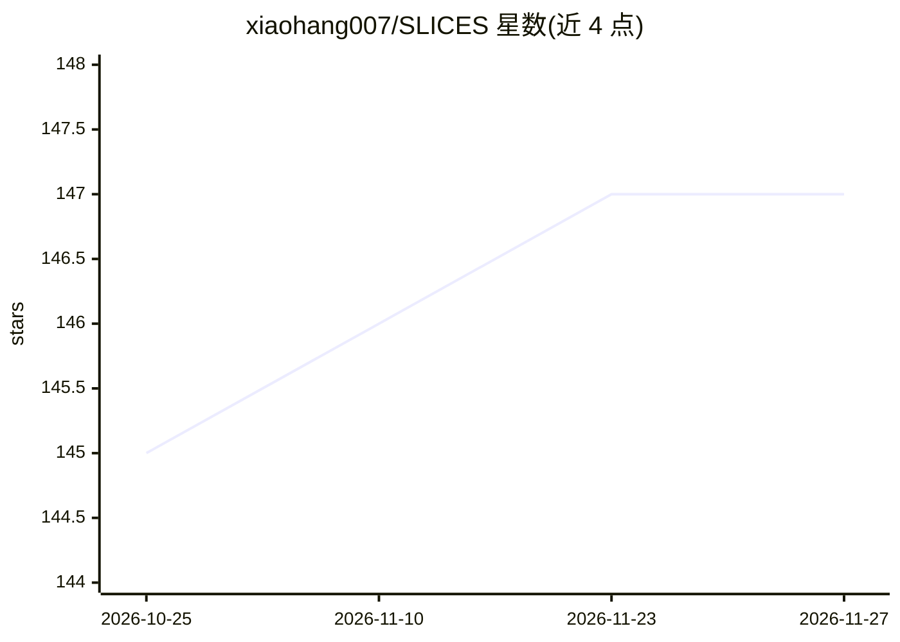

# xiaohang007/SLICES

⭐ 147 · Python · LGPL-2.1 · 推送 2026-11-09 · [GitHub](https://github.com/xiaohang007/SLICES) · [官网](https://www.nature.com/articles/s41467-023-42870-7) · 组织维护 · 中文 README

**晶体结构字符串编码与逆设计材料生成工具**

SLICES 是一种可逆且不变的晶体结构字符串表示工具，支持晶体结构的编码与解码、重建，并基于生成式深度学习生成具有目标性能的新材料。功能包括 SLICES 字符串编解码（Text2Crystal）、MatterGPT 按性能做固体材料逆设计、SLICES-PLUS 加入晶系约束。提供 PyPI 包与完整仓库两路安装，环境由 uv 锁定，解码默认用 NequIP 力场做结构弛豫（首次运行需本机编译）。仅支持 Linux x86_64（含 WSL2），Python ≥ 3.10。配套 Hugging Face 在线转换器与 MatterGPT Demo。

## 筛选速览

| 维度 | 判定 | 备注 |
|---|---|---|
| AI 角色 | `ai-native` | 本体是模型或模型工具 |
| 许可风险 | `viral` | LGPL-2.1 |
| 部署形态 | `self-host` | docker 或自建部署 |
| 模型依赖 | — | README 未给出锁定关系 |
| 硬件要求 | — | 无带数字的原话,不猜 |
| 安装摩擦 | `low` | 无编译、无系统依赖或容器化 |
| 成熟度 | — | 结构信号不足 |

## 能力要点

- 晶体结构与 SLICES 字符串的双向转换（Text2Crystal）
- MatterGPT 按目标性能做固体材料逆设计，SLICES-PLUS 支持晶系约束
- 解码默认用 NequIP 力场弛豫，各平台默认结果一致
- 提供 Hugging Face 在线 CIF/SLICES 转换器与 MatterGPT Demo

## 适用场景

- 将晶体结构编码为 SLICES 字符串再解码重建
- 按目标性能逆设计固体材料
- 在整个 Materials Project 数据库中做新颖性检查和 EAH 计算
- 在线完成 CIF 与 SLICES 格式互转

## 场景标签

`科研工具` · 领域:学习与行业

## 证据(README 行号)

> L3: The **Simplified Line-Input Crystal-Encoding System (SLICES)** is the first invertible and invariant crystal represe
> L21: 3. **Inverse design of solid-state materials with desired properties using MatterGPT**
> L40: uv pip install slices --torch-backend=auto   # 自动选择 CPU 或与显卡驱动匹配的 CUDA 版 PyTorch

## 星数曲线

2026-10-25 145 → 2026-11-27 147（+2）

---
*卡片 v1 · prompt 1.4 · 生成 2026-11-27 · 置信度 high · 依据 README sha `d23ab210d03b` · [字段定义](../../DATASET.md)*
