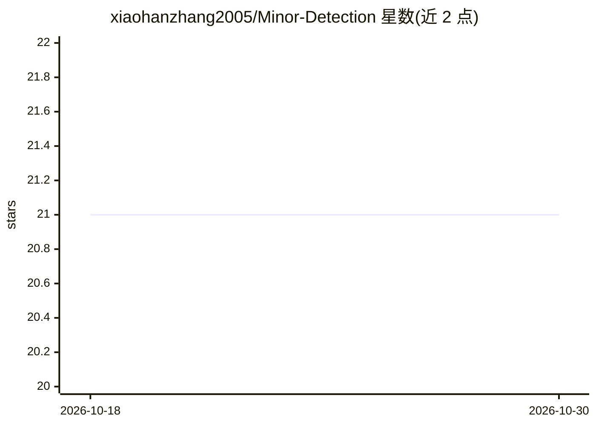

# xiaohanzhang2005/Minor-Detection

⭐ 21 · Python · 推送 2026-04-13 · [GitHub](https://github.com/xiaohanzhang2005/Minor-Detection) · 个人维护 · 中文 README

**面向 AI 拟人化互动的疑似未成年人识别智能体**

为 AI 陪伴、教育、客服、社区审核等对话产品提供的可嵌入未成年人风险治理能力层：通过 Trigger 触发边界判断、多维证据融合（单/多会话、时间线索、画像、RAG 相似案例）输出未成年人概率、证据链与风险等级，并衔接未成年人模式切换、人工复核等下游动作。配套离线自进化链路（评测→诊断→优化→晋级/回滚）并保留人审门禁。以 Python 项目提供，含 Streamlit 工作台、Skill 形态与公开数据集（Benchmark 8,328 条、RAG 案例库 5,829 条、Trigger-Eval 160 条），需配置 OpenAI-compatible API Key 运行。

## 筛选速览

| 维度 | 判定 | 备注 |
|---|---|---|
| AI 角色 | `ai-native` | 本体是模型或模型工具 |
| 许可风险 | `none` | — |
| 部署形态 | `library` | 以包/库形式分发 |
| 模型依赖 | — | README 未给出锁定关系 |
| 硬件要求 | — | 无带数字的原话,不猜 |
| 安装摩擦 | `low` | 无编译、无系统依赖或容器化 |
| 成熟度 | — | 结构信号不足 |

## 能力要点

- 两阶段设计：先触发边界判断，再做深度未成年人识别
- 多维证据融合输出概率、画像、证据链与风险等级
- 离线自进化链路（评测→诊断→优化→晋级/回滚）并保留人审门禁
- 公开 Benchmark/RAG 案例库/Trigger-Eval 三类数据集，Skill 可经 ClawHub/Skillhub 调用

## 适用场景

- AI 陪伴或对话产品中自动切换未成年人模式
- 审核中台与人工复核的疑似未成年人分流
- 家长侧提醒与高风险用户预警联动

## 场景标签

 · 领域:AI 安全/内容风控

## 证据(README 行号)

> L3:  面向 AI 拟人化互动的自进化未成年人识别智能体
> L15:  为 AI 陪伴、教育、客服、社区审核等对话产品提供未成年人识别、证据链输出、风险分级与可持续优化能力。
> L25: - 如何输出可审计的证据链与风险等级

## 星数曲线

2026-10-18 21 → 2026-10-30 21（+0）

---
*卡片 v1 · prompt 1.4 · 生成 2026-10-28 · 置信度 mid · 依据 README sha `94787d9d2d40` · [字段定义](../../DATASET.md)*
