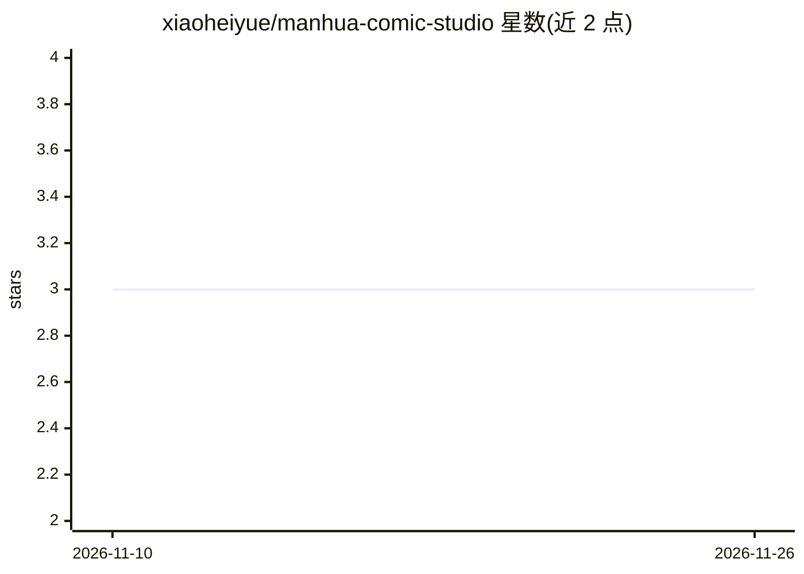

# xiaoheiyue/manhua-comic-studio

⭐ 3 · Python · Apache-2.0 · 推送 2026-11-06 · [GitHub](https://github.com/xiaoheiyue/manhua-comic-studio) · 个人维护 · 中文 README

**给小说作者：本地自动生成彩色条漫与多格漫画页**

本地运行的漫画生成流水线：输入小说文本，经精修、内容分析、分镜、分页排版、图像生成、气泡自动排版，输出条漫长图、分镜页与 PDF/ZIP。图像推理在本机 ComfyUI 完成，文本分析走 OpenAI 兼容接口；提供 365 画风库、74 种分页版式、出图自检返修与角色一致性机制。权重不随仓库分发，需用脚本下载约 11.3 GB 起步；Windows 优先，Linux/macOS 需自行启动 ComfyUI。

## 筛选速览

| 维度 | 判定 | 备注 |
|---|---|---|
| AI 角色 | `ai-native` | 本体是模型或模型工具 |
| 许可风险 | `permissive` | Apache-2.0 |
| 部署形态 | `library` | 以包/库形式分发 |
| 模型依赖 | — | README 未给出锁定关系 |
| 硬件要求 | `gpu-8g` | |
| 安装摩擦 | `low` | 无编译、无系统依赖或容器化 |
| 成熟度 | — | 结构信号不足 |

## 能力要点

- 365 画风 × 36 主题色 × 40 阶调，按故事气质自动推荐画风
- 74 种分页版式按内容自动编页选版式
- 逐气泡坐标定位填字，按细节密度与肤色网格避开人脸
- 每格出图后自检白边/溢出/全黑，低于阈值自动重画

## 适用场景

- 把我写的小说一键转成可下滑阅读的彩色条漫
- 为角色生成三视图、表情包、海报等衍生图像素材
- 本地导出漫画 PDF，不经账号与云服务

## 场景标签

`图像生成` · 领域:内容生成

## 证据(README 行号)

> L3: **把一篇小说，自动做成一套能往下滑的彩色条漫 / 一页多格漫画页。**
> L42: |**本地优先**|图像推理全在本机 ComfyUI；只有文本分析走可替换的 OpenAI 兼容接口|
> L190: |`TEXT_API_HOST` / `TEXT_MODEL`|`https://api.deepseek.com` / `deepseek-flash`|文本服务，任意 OpenAI 兼容端点均可|

## 星数曲线

2026-11-10 3 → 2026-11-26 3（+0）

---
*卡片 v1 · prompt 1.4 · 生成 2026-11-26 · 置信度 high · 依据 README sha `2c9405170b3d` · [字段定义](../../DATASET.md)*
