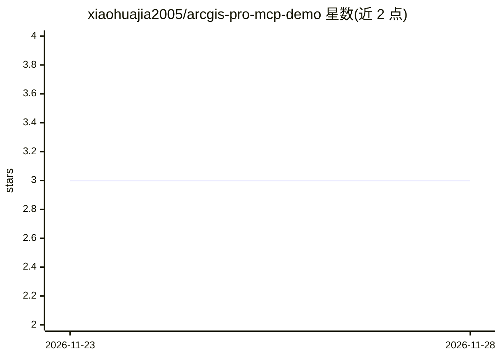

# xiaohuajia2005/arcgis-pro-mcp-demo

⭐ 3 · JavaScript · MIT · 推送 2026-11-24 · [GitHub](https://github.com/xiaohuajia2005/arcgis-pro-mcp-demo) · 个人维护 · 中文 README

**GIS Super-Agent 的 Worker：把子任务翻译成 arcpy 驱动 ArcGIS Pro**

作为 GIS 领域 Super-Agent 的执行层 Worker Agent，接收上层下发的单个子任务，通过本地 MCP Server（stdio/JSON-RPC，16 个工具）调用 arcpy 驱动本机已授权的 ArcGIS Pro，覆盖工程管理、数据查看、空间分析（缓冲/裁剪/投影）、地图导出与任意 Python 兜底执行。因 ArcGIS Pro 自带 Python 3.9 装不上 MCP SDK，采用 Node 协议层 + Python 执行层的双进程架构。仅支持 Windows 本地单用户运行，强依赖 ArcGIS Pro 许可，未做生产级加固。

## 筛选速览

| 维度 | 判定 | 备注 |
|---|---|---|
| AI 角色 | `ai-ecosystem` | LLM/agent 周边工具 |
| 许可风险 | `permissive` | MIT |
| 部署形态 | `desktop` | 安装包/桌面程序 |
| 模型依赖 | — | README 未给出锁定关系 |
| 硬件要求 | — | 无带数字的原话,不猜 |
| 安装摩擦 | `low` | 无编译、无系统依赖或容器化 |
| 成熟度 | `idea` | |

## 能力要点

- 16 个 MCP 工具分五组：环境工程、数据查看、空间分析、成果输出、兜底执行
- 自动处理坐标系前置判断（如 WGS84 数据先投影 CGCS2000 再做米制缓冲）
- Node 协议层 + Python arcpy 执行层的双进程架构，规避 Python 3.9 与 MCP SDK 版本冲突
- 附 doctor.mjs 自检脚本与技术难点记录文档

## 适用场景

- 让上层 Super-Agent 通过 MCP 调用 ArcGIS Pro 做缓冲、裁剪、投影等空间分析
- 用自然语言指令驱动本机 ArcGIS Pro 打开工程、查图层并出图
- 将 GIS 执行能力以工具集形式接入 DeepSeek Harness 等客户端

## 场景标签

`工作流自动化` · 领域:效率与自动化

## 证据(README 行号)

> L7: 技术上它是一个本地 MCP Server（16 个工具），运行在 Windows 上，直接驱动本机已授权的 ArcGIS Pro。
> L36: 传输走 MCP stdio（JSON-RPC），Super-Agent 把它当成一组可调用的工具。
> L168: Worker 自己不是客户端，它由上层 Super-Agent 以 MCP 客户端身份拉起（stdio 子进程）。

## 星数曲线

2026-11-23 3 → 2026-11-28 3（+0）

---
*卡片 v1 · prompt 1.4 · 生成 2026-11-23 · 置信度 mid · 依据 README sha `6a87934dfbdc` · [字段定义](../../DATASET.md)*
