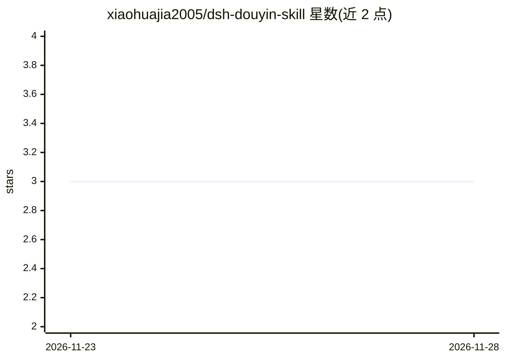

# xiaohuajia2005/dsh-douyin-skill

⭐ 3 · JavaScript · MIT · 推送 2026-11-22 · [GitHub](https://github.com/xiaohuajia2005/dsh-douyin-skill) · 个人维护 · 中文 README

**在 Edge 中自动刷抖音与回私信的 DSH 插件**

运行于 DSH 宿主的抖音自动化插件，在本机 Microsoft Edge 中操作抖音网页版，将「观看」与「私信回复」拆为互不阻塞的两条服务。以人格卡、长期记忆、梗库、平台证据四层约束模型输出，仅回复用户勾选的许可会话；提供补答、评论去重、自检诊断、观看日报等功能。要求 Windows 10/11、Node >= 22.13，模型需支持图片；明确不读取正文、不代付款、发送结果不明时不自动重发。

## 筛选速览

| 维度 | 判定 | 备注 |
|---|---|---|
| AI 角色 | `ai-native` | 本体是模型或模型工具 |
| 许可风险 | `permissive` | MIT |
| 部署形态 | `library` | 以包/库形式分发 |
| 模型依赖 | — | README 未给出锁定关系 |
| 硬件要求 | — | 无带数字的原话,不猜 |
| 安装摩擦 | `low` | 无编译、无系统依赖或容器化 |
| 成熟度 | — | 结构信号不足 |

## 能力要点

- 许可名单机制：仅回复用户勾选的会话，默认不自行添加
- 观看与聊天双服务架构，运行时互不阻塞
- 383 项零第三方断言库的单元测试，含隐私红线测试
- 一键自检覆盖浏览器、Node 版本、锁状态与评论控件可识别性

## 适用场景

- 让代理按人格卡代为回复抖音私信
- 在时段与额度内自动观看抖音视频并生成日报
- 检测抖音改版导致的评论控件不可识别问题

## 场景标签

`浏览器自动化` `AI 助手` · 领域:效率与自动化

## 证据(README 行号)

> L5: 它在本机 Microsoft Edge 里真实操作抖音网页版，把「看视频」和「回私信」拆成两条互不阻塞的常驻服务，中间用**人格卡 + 长期记忆 + 梗库 + 平台证据**四层约束模型输出。设计目标不是「回得快」，而是**回得像这个
> L87: |模型|插件版复用宿主已配置的、**支持图片**的模型|
> L119: 1. DSH「模型」页先配好提供商 → 本插件里选一个**支持图片**的模型（插件不重复填写主模型 Key）。

## 星数曲线

2026-11-23 3 → 2026-11-28 3（+0）

---
*卡片 v1 · prompt 1.4 · 生成 2026-11-23 · 置信度 mid · 依据 README sha `b1e18ae4eea3` · [字段定义](../../DATASET.md)*
