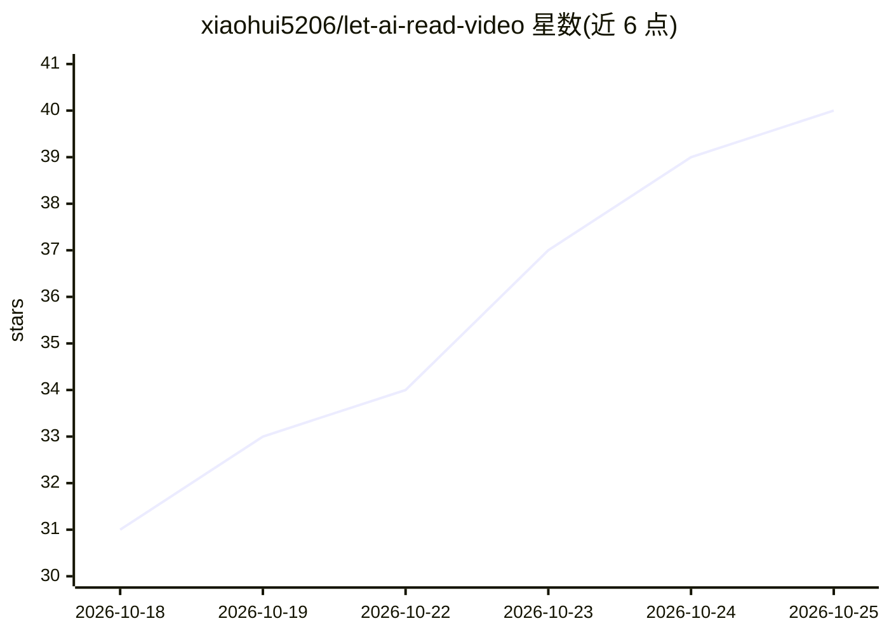

# xiaohui5206/let-ai-read-video

⭐ 42 · Python · MIT · 推送 2026-10-07 · [GitHub](https://github.com/xiaohui5206/let-ai-read-video) · 个人维护 · 中文 README

**本地视频阅读工具：B站/本地视频转为带时间戳的文稿与关键帧**

在本地把B站链接、本地文件或B站客户端缓存处理为带时间戳的文字稿（faster-whisper GPU 转写）与场景感知关键帧（ffmpeg 抽帧），可导出 TXT/SRT/PDF，产物含 t=MM:SS 时间戳与结构化 JSON。提供浏览器 Web UI（127.0.0.1:8765，无需 Agent），同时保留 SKILL.md Agent 工作流与 CLI。限 Windows + Python 3.10+，首次安装需联网下载 ffmpeg/yt-dlp 与模型权重；转写不调用第三方云端音视频 API。

## 筛选速览

| 维度 | 判定 | 备注 |
|---|---|---|
| AI 角色 | `ai-native` | 本体是模型或模型工具 |
| 许可风险 | `permissive` | MIT |
| 部署形态 | `None` |  |
| 模型依赖 | — | README 未给出锁定关系 |
| 硬件要求 | — | 无带数字的原话,不猜 |
| 安装摩擦 | `medium` | 含编译或系统依赖之一 |
| 成熟度 | — | 结构信号不足 |

## 能力要点

- faster-whisper GPU 转写 + ffmpeg 场景感知抽帧，双通道带 t=MM:SS 时间戳
- 支持视频链接/本地文件/B站缓存三种来源，多P与批量处理
- 本地 Web UI（仅监听 127.0.0.1），也可作为 AI Agent skill（SKILL.md）与 CLI 使用
- 产物含 TXT/SRT/关键帧 PDF 及 transcript.json 等结构化数据

## 适用场景

- 把B站视频转成带时间戳的文字稿和关键帧便于阅读检索
- 给 AI Agent 提供可引用时间戳的视频内容输入
- 离线处理本地视频生成 PDF 关键帧摘录

## 场景标签

`语音识别` `多模态` · 领域:感知与多模态

## 证据(README 行号)

> L1: # Let AI Read Video!（video-watch）v2.0.0
> L3: 把 B站视频（链接 / 本地文件 / 客户端缓存）在本机处理成**带时间戳的文字稿 + 关键帧 + 可导出的 PDF**。浏览器里点按钮即可完成，**不需要 AI Agent，数据不出机**。
> L5: *Give any AI agent the ability to truly watch videos — local media preprocessing, zero external audio/video APIs. On
> L72: SKILL.md 的 Agent 工作流、`watch.py` 命令行、review/refine 审查补帧协议 全部保留，与 Web UI 共存。

## 星数曲线

2026-10-18 31 → 2026-10-25 40（+9）

---
*卡片 v1 · prompt 1.4 · 生成 2026-10-25 · 置信度 high · 依据 README sha `da0038c75d1f` · [字段定义](../../DATASET.md)*
