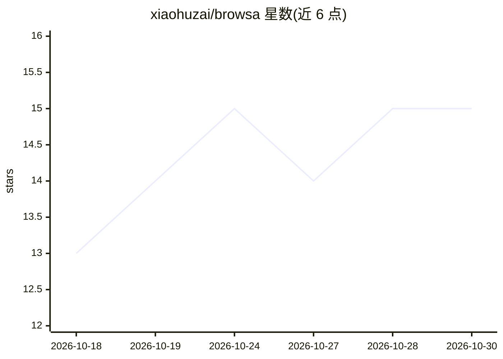

# xiaohuzai/browsa

⭐ 15 · JavaScript · MIT · 推送 2026-10-29 · [GitHub](https://github.com/xiaohuzai/browsa) · [官网](https://xiaohuzai.github.io/browsa/) · 个人维护 · 中文 README

**浏览器侧边栏 AI 助手：附加网页/视频/PDF 与自有 LLM 对话**

Chrome/Edge 116+ 侧边栏扩展，把正在浏览的文章、视频（YouTube/Bilibili 等）、PDF、Office 文档带入对话。模型自备：通过 Agent Bridge 桥接 Codex/Claude Code/Gemini CLI 等本地智能体，或配置 OpenAI、Anthropic、Ollama 等兼容端点，API Key 存本地。页面解析在本机完成（docling 编译为 WASM），视频字幕/转写生成可点击时间戳笔记。MIT 开源，可从 Chrome 商店或 GitHub Releases 手动加载安装。

## 筛选速览

| 维度 | 判定 | 备注 |
|---|---|---|
| AI 角色 | `ai-native` | 本体是模型或模型工具 |
| 许可风险 | `permissive` | MIT |
| 部署形态 | `library` | 以包/库形式分发 |
| 模型依赖 | local-ok | 支持本地模型 |
| 硬件要求 | — | 无带数字的原话,不猜 |
| 安装摩擦 | `low` | 无编译、无系统依赖或容器化 |
| 成熟度 | — | 结构信号不足 |

## 能力要点

- Agent Bridge 桥接 Codex / Claude Code / Gemini CLI 等本地智能体，沿用其已有认证
- 视频/播客生成带可点击 [mm:ss] 时间戳的笔记，无字幕视频自动转写（ASR）
- PDF / Office 文档本机解析与转换（表格、多栏、插图保留）
- 支持 OpenAI Chat Completions / Responses / Anthropic Messages 兼容端点

## 适用场景

- 阅读文章或论文时在侧边栏向自己的 AI 提问，无需复制粘贴
- 看 YouTube / Bilibili 视频时生成可跳转回原时刻的笔记
- 划选网页文字就地解释或翻译，附加 GitHub 仓库、飞书文档等页面与 AI 讨论

## 场景标签

`AI 助手` `文档问答` `语音识别` · 领域:对话与助手

## 证据(README 行号)

> L15: browsa 是一个 Chrome / Edge 侧边栏扩展：把正在看的文章、视频、PDF 带进对话，让**你自己的 AI** 在旁边帮你读懂。不用复制粘贴，也不用离开页面。通过 Agent Bridge 接入 **Codex /
> L17: **扩展免费，MIT 开源。** 自备模型或 Agent。API Key 保存在本地，用于向你配置的服务进行身份验证。

## 星数曲线

2026-10-18 13 → 2026-10-30 15（+2）

---
*卡片 v1 · prompt 1.4 · 生成 2026-10-30 · 置信度 mid · 依据 README sha `b20b0d6ab773` · [字段定义](../../DATASET.md)*
