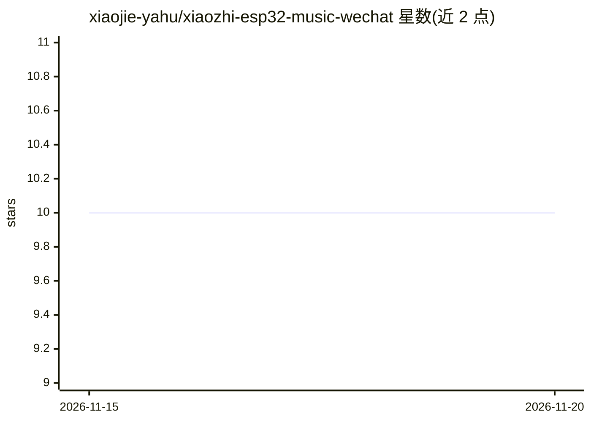

# xiaojie-yahu/xiaozhi-esp32-music-wechat

⭐ 10 · C++ · MIT · 推送 2026-02-04 · [GitHub](https://github.com/xiaojie-yahu/xiaozhi-esp32-music-wechat) · 个人维护 · 中文 README

**ESP32 小智 AI 语音机器人的音乐播放与微信留言固件**

基于 Maggotxy/xiaozhi-esp32-music 二次开发的 ESP32 固件，MIT 许可。在原音乐播放基础上新增微信留言推送（经 WxPusher 服务，语音指令提取留言并推送）并修复 ML307 4G 网络兼容性。语音交互采用流式 ASR + LLM + TTS 架构，默认接入 xiaozhi.me 官方服务器，通过 MCP 协议调用 `self.music.play_song` 与 `self.message.send_to_wechat` 工具。支持 ESP32-S3/C3/P4 等芯片平台（ESP32C3 芯片开发板暂不支持）。提供免开发环境固件烧录与 ESP-IDF 5.4+ 源码编译两种路径。

## 筛选速览

| 维度 | 判定 | 备注 |
|---|---|---|
| AI 角色 | `ai-native` | 本体是模型或模型工具 |
| 许可风险 | `permissive` | MIT |
| 部署形态 | `None` |  |
| 模型依赖 | — | README 未给出锁定关系 |
| 硬件要求 | — | 无带数字的原话,不猜 |
| 安装摩擦 | `low` | 无编译、无系统依赖或容器化 |
| 成熟度 | `idea` | |

## 能力要点

- 语音指令控制音乐播放（self.music.play_song MCP 工具）与歌词显示
- 微信留言推送：语音识别意图并经 WxPusher 推送到微信，支持中文 URL 编码
- Wi-Fi 与 ML307 Cat.1 4G 两种联网方式，离线语音唤醒 ESP-SR
- 流式 ASR + LLM + TTS 架构，支持多语言与多种预设角色

## 适用场景

- 给小智类 ESP32 语音机器人加上唱歌与歌词显示能力
- 通过语音把留言推送到自己的微信
- 面包板或开源开发板自制 AI 语音聊天玩具

## 场景标签

`语音 Agent` · 领域:对话与助手

## 证据(README 行号)

> L67: 小智 AI 聊天机器人作为一个语音交互入口，利用 Qwen / DeepSeek 等大模型的 AI 能力，通过 MCP 协议实现多端控制。
> L81: - 🤖 基于流式 ASR + LLM + TTS 架构的语音交互

## 星数曲线

2026-11-15 10 → 2026-11-20 10（+0）

---
*卡片 v1 · prompt 1.4 · 生成 2026-11-19 · 置信度 high · 依据 README sha `a4197479ed37` · [字段定义](../../DATASET.md)*
