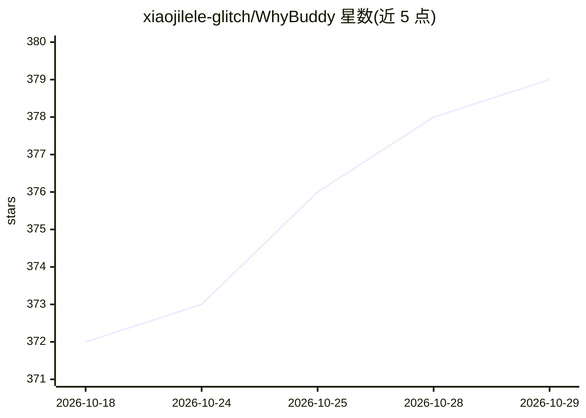

# xiaojilele-glitch/WhyBuddy

⭐ 379 · TypeScript · MIT · 推送 2026-09-22 · [GitHub](https://github.com/xiaojilele-glitch/WhyBuddy) · [官网](http://www.miantuan.ai/) · 个人维护 · 中文 README

**一句话需求推演出可运行产品的门控推演引擎**

SlideRule（中文名面团 AI）是一个产品推演引擎：输入一句话，经 spec→pages→structure→bind→closure 的门控流水线生成包含页面、RBAC、工作流、数据与 AIGC 的五系统 JSON，并在浏览器中作为可操作应用运行，预览无需后端和数据库。每步产物须通过确定性门控，缺失证据则发布闭包失败（fail-closed）。Python FastAPI 引擎为权威，Node 做薄代理。提供 Docker 部署、源码运行与可装入 Trae/Claude 等宿主的 Skill 包；无 LLM key 时回退到确定性模板。

## 筛选速览

| 维度 | 判定 | 备注 |
|---|---|---|
| AI 角色 | `ai-native` | 本体是模型或模型工具 |
| 许可风险 | `permissive` | MIT |
| 部署形态 | `self-host` | docker 或自建部署 |
| 模型依赖 | — | README 未给出锁定关系 |
| 硬件要求 | — | 无带数字的原话,不猜 |
| 安装摩擦 | `low` | 无编译、无系统依赖或容器化 |
| 成熟度 | — | 结构信号不足 |

## 能力要点

- 一句话输入经五跳门控流水线推演出产品结构与规格包
- 推演出的模型在浏览器中作为可运行应用执行，预览零后端零数据库
- fail-closed 发布闭包：证据缺失不给绿灯，checks_ledger 记录每次脚本执行
- 支持 BYOK（OpenAI 兼容 key 留存浏览器）与无 key 确定性模板回退

## 适用场景

- 产品立项前用一次推演替代长期 PRD 对齐来验证方向
- 从一句话生成带 RBAC 与审批流的可运行业务应用原型
- 为 Trae/Claude 等 Agent 宿主安装 Skill 包，输入一句话产出可审查的规格包

## 场景标签

`代码生成` · 领域:编码与开发

## 证据(README 行号)

> L31: **SlideRule** (Chinese product name 面团 AI) is a **product rehearsal engine**. You type one sentence. It rehearses a
> L40: 4. **The model runs as an app in the browser.** Five-system JSON is the schema: pages, RBAC, workflow, data, AIGC —
> L55: Watch a captured end-to-end rehearsal, open finished examples and **run the generated app**, or BYOK (OpenAI-compat

## 星数曲线

2026-10-18 372 → 2026-10-29 379（+7）

---
*卡片 v1 · prompt 1.4 · 生成 2026-10-21 · 置信度 mid · 依据 README sha `38591c55c75c` · [字段定义](../../DATASET.md)*
