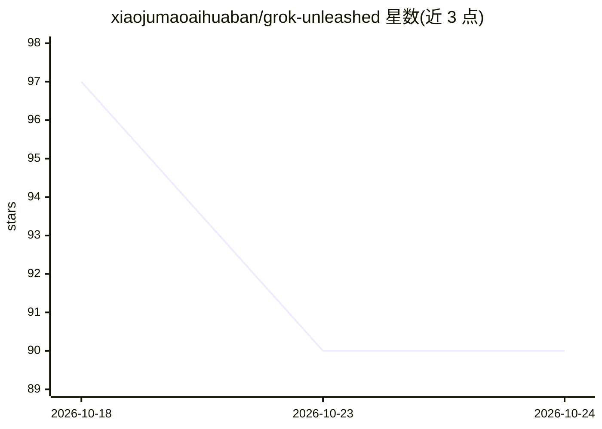

# xiaojumaoaihuaban/grok-unleashed

⭐ 90 · Shell · Apache-2.0 · 推送 2026-09-02 · [GitHub](https://github.com/xiaojumaoaihuaban/grok-unleashed) · 个人维护

**去除 x.ai 依赖与遥测的 grok-build CLI 补丁版，可接任意 OpenAI 兼容端点**

对 xai-org/grok-build（Apache-2.0，基线 commit 8adf901）的非官方补丁构建：删除源码产物上传、工作区快照收集、遥测导出与权限弹窗，并在凭证层切断到 api.x.ai 的路由；修复第三方端点下工具名缺失导致的 502 与 SSE 流式函数调用拼装问题。支持多模型配置，替换 base_url/model/key 即可连接 DeepSeek、Zhipu、Kimi、ollama 或任意兼容中继，上下文窗口至 1M。以 Linux/WSL 单一静态二进制发布，提供 install.sh 或手动 install，附 sha256 校验值；Windows 需经 WSL 调用。作者警告勿运行 grok update，否则官方版功能回归。

## 筛选速览

| 维度 | 判定 | 备注 |
|---|---|---|
| AI 角色 | `ai-ecosystem` | LLM/agent 周边工具 |
| 许可风险 | `permissive` | Apache-2.0 |
| 部署形态 | `desktop` | 安装包/桌面程序 |
| 模型依赖 | local-ok | 支持本地模型 |
| 硬件要求 | — | 无带数字的原话,不猜 |
| 安装摩擦 | `low` | 无编译、无系统依赖或容器化 |
| 成熟度 | — | 结构信号不足 |

## 能力要点

- 删除上传队列、遥测、权限弹窗，并切断到 api.x.ai 的路由
- 修复第三方端点的工具名缺失 502 与流式函数调用拼装
- 多模型配置可切换 DeepSeek/Zhipu/Kimi/ollama/任意兼容中继，上下文窗口至 1M
- 提供 strace 连接核查、上传队列检查与 sha256 校验等验证手段

## 适用场景

- 用 DeepSeek/ollama 等第三方端点跑原本绑定 x.ai 的 agent CLI
- 需要可审计、无遥测的本地 agent 终端工具
- 通过中继服务使用 OpenAI 兼容 API 的 agent 工作流

## 场景标签

 · 领域:LLM 客户端/终端工具

## 证据(README 行号)

> L3: **The grok-build CLI with the leash off.**
> L5: One static binary. Any OpenAI-compatible endpoint. Zero x.ai dependency,
> L56: **2. Give it a key** — any OpenAI-compatible API:
> L119: This is an unofficial patched build. The excellent original CLI is

## 星数曲线

2026-10-18 97 → 2026-10-24 90（-7）

---
*卡片 v1 · prompt 1.4 · 生成 2026-10-23 · 置信度 high · 依据 README sha `a976f5da3de2` · [字段定义](../../DATASET.md)*
