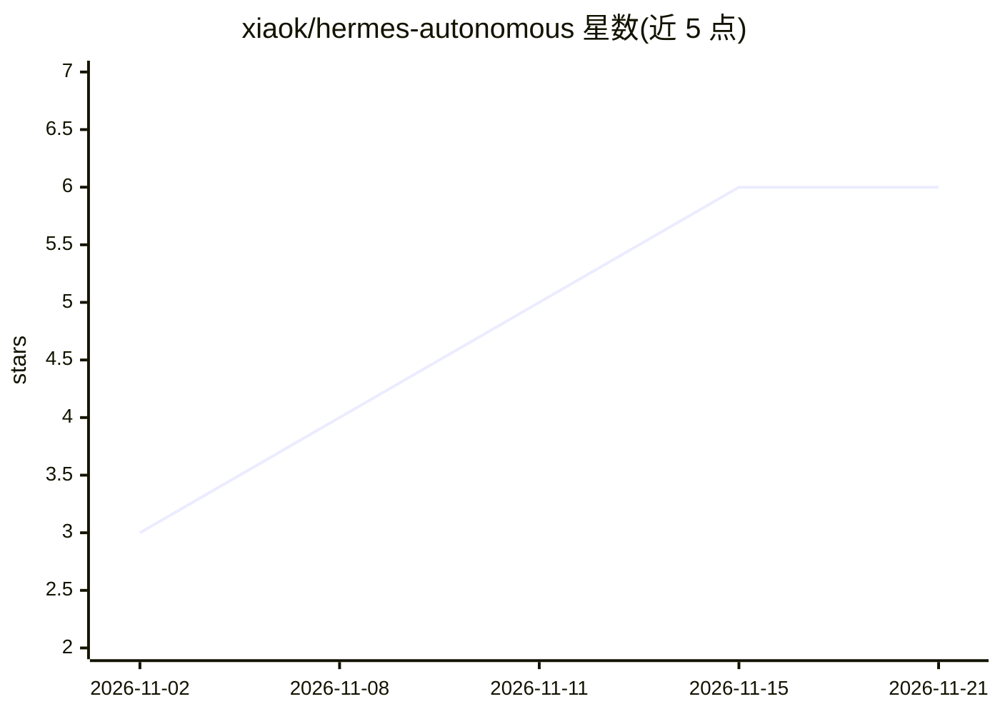

# xiaok/hermes-autonomous

⭐ 6 · Python · MIT · 推送 2026-11-10 · [GitHub](https://github.com/xiaok/hermes-autonomous) · 个人维护 · 中文 README

**让 Hermes Agent 主动回访用户的插件：定时审查对话并发起跟进**

作为 Hermes Agent 的插件运行：每 15 分钟由低成本脚本判断是否值得唤醒，唤醒后读取近几小时对话，更新跟踪面板，并在最多 3 条、90 分钟冷却、夜间静默的硬性门槛内发出跟进消息。消息须经 Due/New/Sourced 三项判断加代码强制的配额限制；用户反应（accepted/ignored/annoyed/useless）会写回并驱动类别静音机制。安装方式为让 agent 执行插件安装命令或手动五条命令/源码软链，要求 --monitor-script 作为唤醒门槛。

## 筛选速览

| 维度 | 判定 | 备注 |
|---|---|---|
| AI 角色 | `ai-native` | 本体是模型或模型工具 |
| 许可风险 | `permissive` | MIT |
| 部署形态 | `None` |  |
| 模型依赖 | — | README 未给出锁定关系 |
| 硬件要求 | — | 无带数字的原话,不猜 |
| 安装摩擦 | `low` | 无编译、无系统依赖或容器化 |
| 成熟度 | — | 结构信号不足 |

## 能力要点

- 双评分线决策：utility 与 care 分开计分
- 四重门槛（Due/New/Sourced/Rationed）+ 代码强制配额与夜间静默
- 用户反应写回并触发类别静音（30 天内 1 annoyed 或 3 ignored）
- 含 doctor 修复与离线决策演练工具 decide.py

## 适用场景

- 让个人助理 agent 主动回访此前聊过的事项（健康、截止日期）
- 天气、价格、网页变动的低频事件提醒
- 避免固定时间摘要式的打扰型通知

## 场景标签

`AI 助手` · 领域:对话与助手

## 证据(README 行号)

> L8: `hermes-autonomous` is a proactivity layer for Hermes Agent:
> L73: every 15 min   a cheap script asks "is anything worth waking up for?"      ~0 tokens
> L181: Tested with Hermes Agent 0.22.2 (`requires_hermes: ">=0.22.2"`).

## 星数曲线

2026-11-02 3 → 2026-11-21 6（+3）

---
*卡片 v1 · prompt 1.4 · 生成 2026-11-20 · 置信度 high · 依据 README sha `45916bd762be` · [字段定义](../../DATASET.md)*
