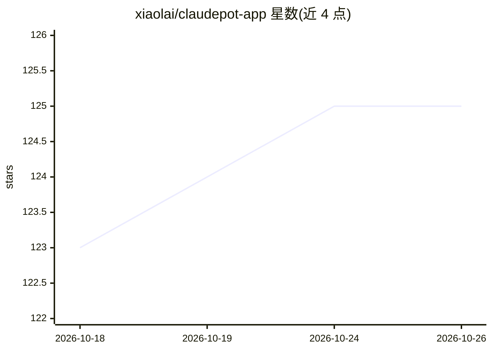

# xiaolai/claudepot-app

⭐ 125 · Rust · ISC · 推送 2026-10-23 · [GitHub](https://github.com/xiaolai/claudepot-app) · [官网](https://claudepot.com) · 个人维护

**Claude Code/Desktop 的桌面控制面板：账号切换、会话监控与调度**

基于 Tauri 2 的 macOS 优先桌面应用（附命令行工具），管理 Claude Code 与 Claude Desktop 的工作流：一键切换多账号、实时查看运行中的会话、用量阈值触发的账号自动轮换、cron 定时执行 claude -p 提示词、跨项目搜索历史会话、安全重命名项目目录、~/.claude/ 磁盘清理（7 天撤销）与导出前剥离 token。还可通过 wrapper 二进制以 claude 接口运行 Bedrock/Vertex/Ollama/vLLM 等非 Anthropic 模型。目前需 Rust 工具链 + Node 20+ 从源码构建，预编译安装包未发布；自述为 beta（0.6.9）。

## 筛选速览

| 维度 | 判定 | 备注 |
|---|---|---|
| AI 角色 | `ai-ecosystem` | LLM/agent 周边工具 |
| 许可风险 | `permissive` | ISC |
| 部署形态 | `None` |  |
| 模型依赖 | local-ok | 支持本地模型 |
| 硬件要求 | — | 无带数字的原话,不猜 |
| 安装摩擦 | `low` | 无编译、无系统依赖或容器化 |
| 成熟度 | `idea` | |

## 能力要点

- 双槽位账号管理（CLI 与 Desktop 独立切换），密钥存 OS keychain
- 用量阈值触发的账号自动轮换（confirm/auto 模式，500 条审计日志）
- 九阶段日志式项目重命名，可恢复可回滚
- 通过 wrapper 二进制以 claude 接口运行 Ollama/vLLM/Bedrock 等第三方模型

## 适用场景

- 同时维护工作与个人 Claude 账号并一键切换
- 定时让 Claude 执行日报类提示词并查看运行状态
- 清理 ~/.claude/ 目录占用并导出脱敏会话记录
- 通过 claude 接口使用非 Anthropic 本地/云模型

## 场景标签

 · 领域:AI 开发者工具/桌面应用

## 证据(README 行号)

> L15: Claudepot is a desktop app — with a matching command-line tool — that sits next to Claude Code and Claude Desktop a
> L101: **Providers** — Run non-Anthropic models (Bedrock, Vertex, Foundry, OpenRouter, Ollama, vLLM, llama.cpp, …) throug

## 星数曲线

2026-10-18 123 → 2026-10-26 125（+2）

---
*卡片 v1 · prompt 1.4 · 生成 2026-10-23 · 置信度 high · 依据 README sha `c1a4118a01d6` · [字段定义](../../DATASET.md)*
