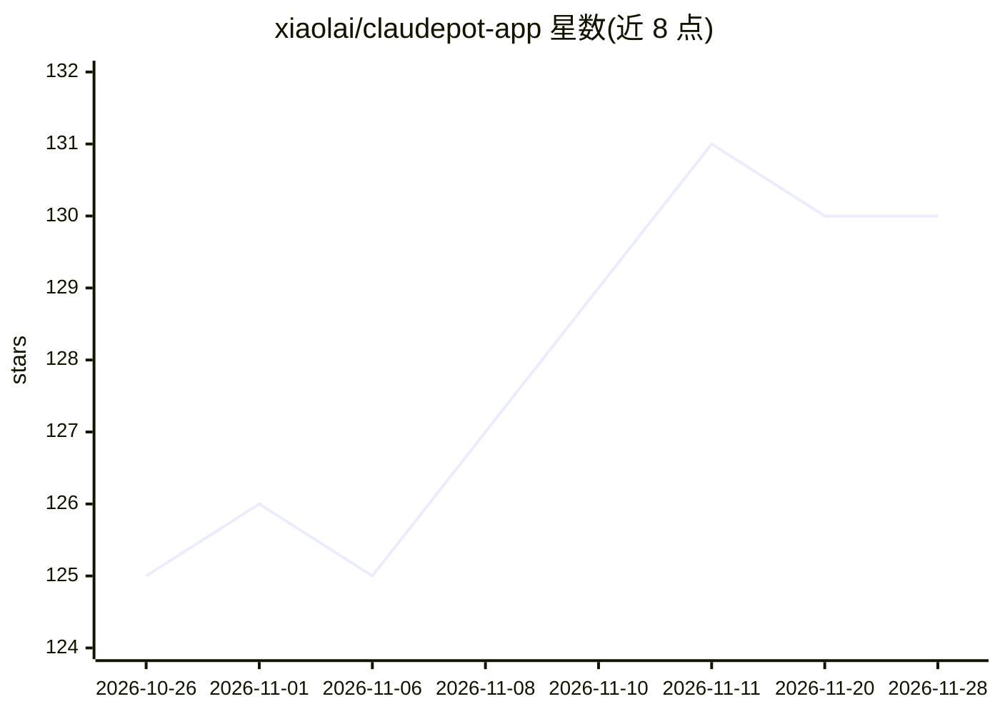

# xiaolai/claudepot-app

⭐ 130 · Rust · ISC · 推送 2026-11-04 · [GitHub](https://github.com/xiaolai/claudepot-app) · [官网](https://claudepot.com) · 个人维护

**管理 Claude Code 与 Claude Desktop 的桌面控制面板**

以 Tauri 2 桌面应用加配套 CLI 的形式，围绕 Claude Code 与 Claude Desktop 提供账号双槽切换、用量阈值触发的账号轮换、cron 定时 prompt、会话历史检索与导出、项目安全重命名、~/.claude/ 磁盘清理（7 天可撤销）、导出前令牌脱敏等功能，共九个侧边栏标签页。秘密存于操作系统钥匙串。目前仅支持源码构建，macOS 优先，Windows/Linux 可构建但打磨较少，预构建安装包尚未提供。

## 筛选速览

| 维度 | 判定 | 备注 |
|---|---|---|
| AI 角色 | `ai-ecosystem` | LLM/agent 周边工具 |
| 许可风险 | `permissive` | ISC |
| 部署形态 | `None` |  |
| 模型依赖 | local-ok | 支持本地模型 |
| 硬件要求 | — | 无带数字的原话,不猜 |
| 安装摩擦 | `low` | 无编译、无系统依赖或容器化 |
| 成熟度 | `idea` | |

## 能力要点

- CLI 与 Desktop 两个独立账号槽一键切换，OAuth/导入/刷新令牌三种添加方式
- 用量窗口（5h/7d/Opus/Sonnet）越限时按规则轮换账号，带 500 条审计日志
- 通过 PATH 包装器路由 Bedrock/Vertex/OpenRouter/Ollama/vLLM/llama.cpp 等到 claude 接口
- 提供 claudepot mcp memory-server 向 agent 暴露记忆数据

## 适用场景

- 在同一台机器上并存并快速切换工作与个人 Claude 账号
- 定时让 Claude 在工作日早上自动运行汇总 prompt
- 清理增长到数 GB 的 ~/.claude/ 目录并找回旧会话

## 场景标签

 · 领域:开发者工具/AI 工作流管理

## 证据(README 行号)

> L5:  A control panel for Claude Code and Claude Desktop.
> L15: Claudepot is a desktop app — with a matching command-line tool — that sits next to Claude Code and Claude Desktop a
> L101: **Providers** — Run non-Anthropic models (Bedrock, Vertex, Foundry, OpenRouter, Ollama, vLLM, llama.cpp, …) throug

## 星数曲线

2026-10-26 125 → 2026-11-28 130（+5）

---
*卡片 v1 · prompt 1.4 · 生成 2026-11-28 · 置信度 high · 依据 README sha `83958fdca043` · [字段定义](../../DATASET.md)*
