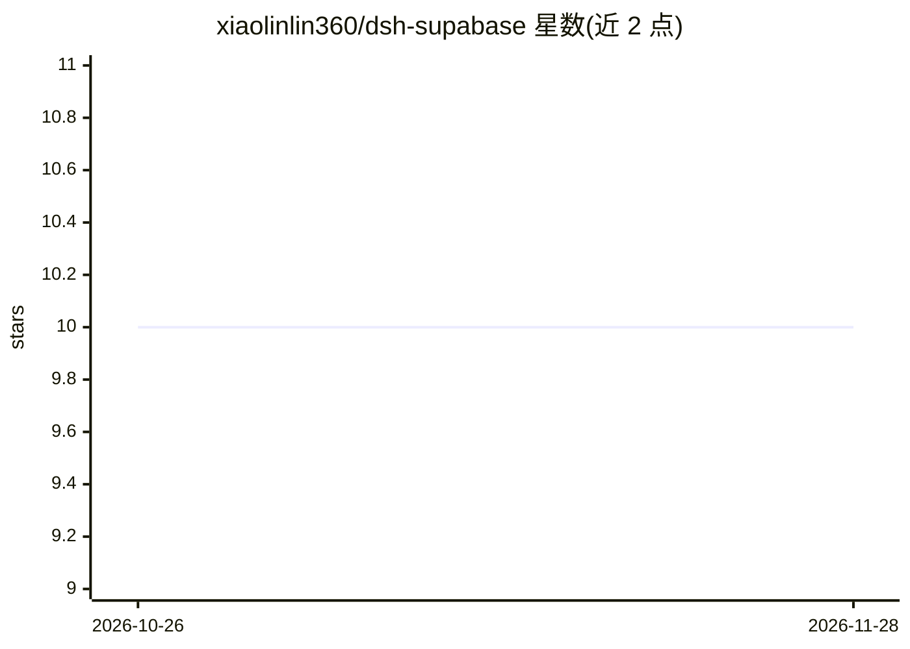

# xiaolinlin360/dsh-supabase

⭐ 10 · JavaScript · MIT · 推送 2026-08-27 · [GitHub](https://github.com/xiaolinlin360/dsh-supabase) · 个人维护 · 中文 README

**让 DeepSeek Harness Agent 用自然语言操作 Supabase 的插件**

Cordis 动态插件，为 DeepSeek Harness 中的 Agent 提供 10 个模型工具：经 PostgREST 的 CRUD、Management API 执行任意 SQL（建表/外键/RLS 策略）、RPC 调用、Storage 建桶与二进制文件直传。密钥经环境变量传递不进命令行与日志，update/delete 强制非空过滤条件防误操作。纯 JS 零依赖，无构建步骤；插件为会话级，进程重启后需重装，持久化打包在路线图中。

## 筛选速览

| 维度 | 判定 | 备注 |
|---|---|---|
| AI 角色 | `ai-ecosystem` | LLM/agent 周边工具 |
| 许可风险 | `permissive` | MIT |
| 部署形态 | `None` |  |
| 模型依赖 | locked-api |  |
| 硬件要求 | — | 无带数字的原话,不猜 |
| 安装摩擦 | `low` | 无编译、无系统依赖或容器化 |
| 成熟度 | — | 结构信号不足 |

## 能力要点

- 10 个工具覆盖 CRUD、SQL、RPC、Storage 建桶/上传
- 密钥经环境变量传给子进程，不进命令行、日志与回显
- update/delete 强制非空 filters 防误操作
- 纯 JS 零依赖，单个 apply(ctx) 函数即插件

## 适用场景

- 让 Agent 查询/更新 Supabase 数据表
- 对话式建表、加外键与 RLS 策略
- 上传本地文件到 Storage 并把公开 URL 写回表字段

## 场景标签

`Agent 框架` · 领域:Agent 开发

## 证据(README 行号)

> L3: 让 DeepSeek Harness 里的 Agent 直接操作你的 Supabase 项目 —— 数据库增删改查、建表/外键/RLS 策略、Storage 桶与文件上传、RPC，全部通过自然语言完成。
> L17: - 📦 **纯 JS、零依赖**：一个 `apply(ctx)` 函数就是整个插件，不需要构建工具
> L21: 在 DSH 会话中使用 Cordis 动态插件工具安装：

## 星数曲线

2026-10-26 10 → 2026-11-28 10（+0）

---
*卡片 v1 · prompt 1.4 · 生成 2026-11-19 · 置信度 high · 依据 README sha `0438678caae9` · [字段定义](../../DATASET.md)*
