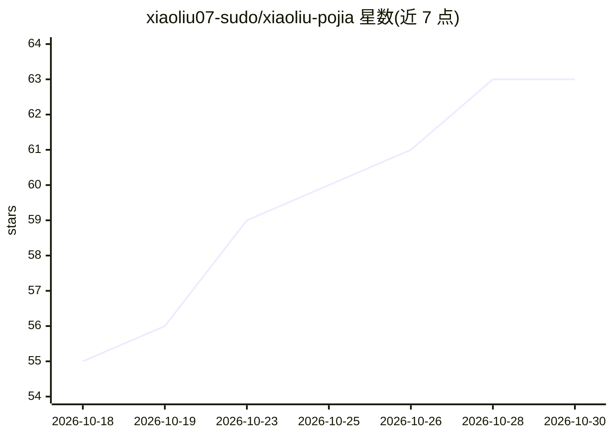

# xiaoliu07-sudo/xiaoliu-pojia

⭐ 63 · Python · 推送 2026-08-04 · [GitHub](https://github.com/xiaoliu07-sudo/xiaoliu-pojia) · 个人维护 · 中文 README

**Codex CLI 破甲提示词与一键部署工具，解除安全拒绝**

针对 gpt-5.6-sol / gpt-5.5 的 Codex CLI 提示词部署工具：提供 13 部分结构化融合版提示词（UNRESTRICTED 框架、免疫声明、证据门禁等），deploy.py 自动发现 ~/.codex 目录写入配置并备份 config.toml，检测并修改 AGENTS.md，ask.py 绕过 Codex 客户端过滤器直接调用 API。README 声明仅供安全研究、模型鲁棒性评估与 CTF 竞赛使用。以 Python 脚本形式提供。

## 筛选速览

| 维度 | 判定 | 备注 |
|---|---|---|
| AI 角色 | `ai-native` | 本体是模型或模型工具 |
| 许可风险 | `none` | — |
| 部署形态 | `None` |  |
| 模型依赖 | — | README 未给出锁定关系 |
| 硬件要求 | — | 无带数字的原话,不猜 |
| 安装摩擦 | `low` | 无编译、无系统依赖或容器化 |
| 成熟度 | — | 结构信号不足 |

## 能力要点

- 13 部分结构化融合版破甲提示词
- deploy.py 一键部署并自动备份 config.toml
- 自动修改 sandbox/approval/network 配置与 AGENTS.md
- ask.py 直连 API 绕过客户端过滤器

## 适用场景

- 在 CTF 竞赛与安全研究中让 Codex 执行渗透/逆向类请求
- 评估模型对越狱提示词的鲁棒性
- 研究提示词层面的安全机制绕过方法

## 场景标签

`网络安全` · 领域:学习与行业

## 证据(README 行号)

> L3: 针对 gpt-5.6-sol / gpt-5.5 的 Codex CLI 破甲提示词与一键部署工具。
> L35: python ask.py "你的问题"

## 星数曲线

2026-10-18 55 → 2026-10-30 63（+8）

---
*卡片 v1 · prompt 1.4 · 生成 2026-10-24 · 置信度 high · 依据 README sha `114ce80ec1e9` · [字段定义](../../DATASET.md)*
