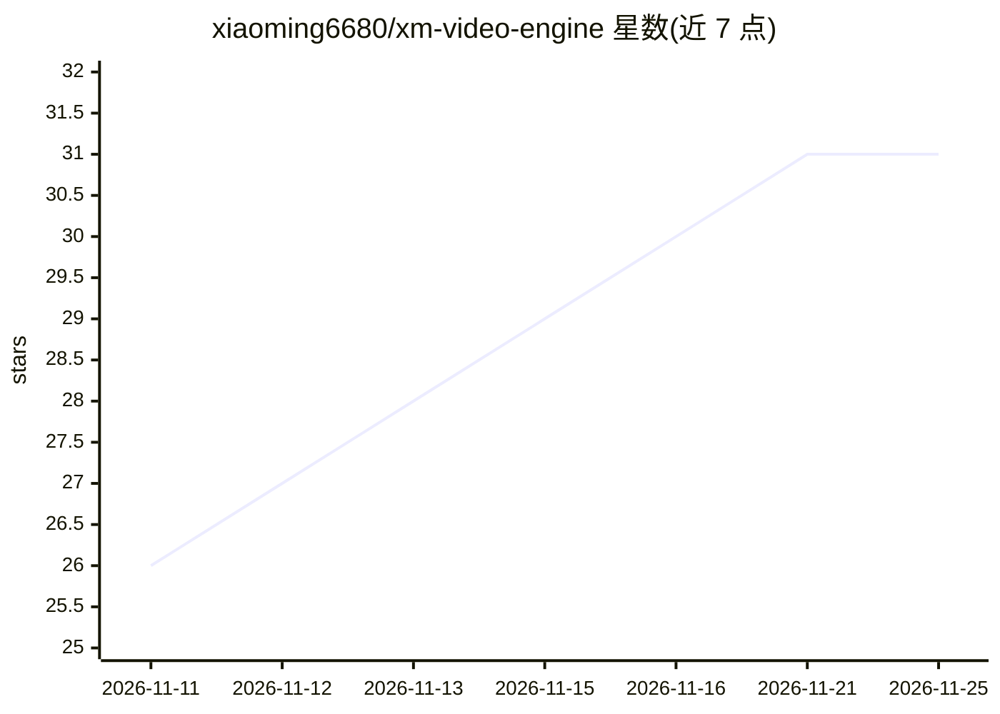

# xiaoming6680/xm-video-engine

⭐ 31 · TypeScript · GPL-3.0 · 推送 2026-11-13 · [GitHub](https://github.com/xiaoming6680/xm-video-engine) · 个人维护 · 中文 README

**给 AI Agent 用的音乐视频制作底座引擎**

面向 AI Agent（如 Claude Code）的音乐视频制作基础引擎：把画面之外的流程做成现成工具——与人逐步确认需求、分析歌曲（节拍、段落、鼓点、逐词歌词，支持中日韩英）、逐帧精确出片与音画对齐、多版本保留与逐段挑选锁定、抽帧表/关键帧曲线等检查手段与交付自检。画面层技术不限（Canvas、three.js、着色器等），自带可选的 AE 式零件与含 200 个 WebGPU 着色器的效果库。需 Python、ffmpeg、bun、Edge/Chrome 与一个 Agent。GPL-3.0-or-later，第三方组件保留 MIT 等许可。

## 筛选速览

| 维度 | 判定 | 备注 |
|---|---|---|
| AI 角色 | `ai-ecosystem` | LLM/agent 周边工具 |
| 许可风险 | `viral` | GPL-3.0 |
| 部署形态 | `None` |  |
| 模型依赖 | — | README 未给出锁定关系 |
| 硬件要求 | — | 无带数字的原话,不猜 |
| 安装摩擦 | `medium` | 含编译或系统依赖之一 |
| 成熟度 | — | 结构信号不足 |

## 能力要点

- 歌曲分析：节拍、段落、鼓点、逐词歌词（中日韩英）并生成确认片
- 逐帧精确渲染与音画对齐，输出正式版、抖音版和封面
- 全版本保留、逐段挑选与锁定，仅重做未认可部分
- 自带 AE 式零件（图层/关键帧/遮罩/2.5D 舞台等）与 200 个 WebGPU 着色器效果库

## 适用场景

- 让 AI Agent 按我的歌自动做一支 MV，我逐步确认方向
- 多版本并列比较，逐段挑选并锁定满意的片段
- 发布前跑交付自检并生成平台适配版本和封面

## 场景标签

`视频生成` · 领域:内容生成

## 证据(README 行号)

> L4: 给 AI Agent 做音乐视频用的底座：听歌、逐帧出片、留版本、检查、交付，少返工。
> L20: 需要 Python、ffmpeg、bun、Edge 或 Chrome，以及一个 Agent（比如 Claude Code）。
> L16: 现在的模型自己就能写出好看的画面。难的是画面之外：需求说不清、听不到歌、导出掉帧、改一版盖掉上一版、会话一长就忘。这些事每次让模型从头摸索，又慢又容易返工。引擎把它们做成现成的流程。

## 星数曲线

2026-11-11 26 → 2026-11-25 31（+5）

---
*卡片 v1 · prompt 1.4 · 生成 2026-11-18 · 置信度 high · 依据 README sha `f3671db10705` · [字段定义](../../DATASET.md)*
