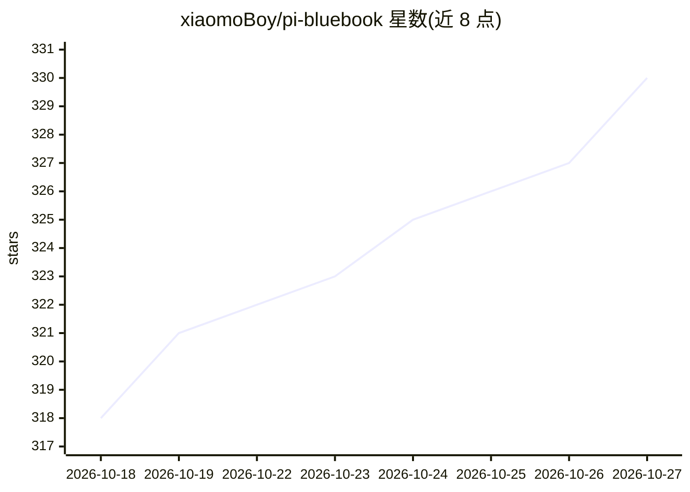

# xiaomoBoy/pi-bluebook

⭐ 330 · Markdown · MIT · 推送 2026-10-11 · [GitHub](https://github.com/xiaomoBoy/pi-bluebook) · [官网](https://pi.xiaomovps.com) · 个人维护 · 中文 README

**Pi Coding Agent 中文学习手册：从安装到长期工作流**

面向中文初学者的非官方 Pi Coding Agent 学习手册网站（VitePress 构建），以“场景→概念→实操→验收”结构组织导论、序章、5 个模块、14 课、1 篇 Agent Loop 原理和 8 个配套案例，覆盖安装、登录、Session、Context、Skill、Extension、Subagent 与安全验收；主线基于 macOS，另提供 Windows Git Bash 独立路径。易变化信息标注核验日期，以 Pi 官方文档与源码为准。本地预览网站不需安装 Pi 或模型账号。

## 筛选速览

| 维度 | 判定 | 备注 |
|---|---|---|
| AI 角色 | `ai-knowledge` | 知识聚合/清单类 |
| 许可风险 | `permissive` | MIT |
| 部署形态 | `library` | 以包/库形式分发 |
| 模型依赖 | — | README 未给出锁定关系 |
| 硬件要求 | — | 无带数字的原话,不猜 |
| 安装摩擦 | `low` | 无编译、无系统依赖或容器化 |
| 成熟度 | — | 结构信号不足 |

## 能力要点

- 14 课 + 原理串联 + 8 个配套案例的完整学习路径
- macOS 与 Windows Git Bash 双路径说明
- 动态信息标注核验日期，以 Pi 官方文档/源码为准
- 含 Earendil 授权的十四篇官方文章中文译文

## 适用场景

- 中文环境下从零安装并上手 Pi Coding Agent
- 系统学习会话、上下文、Skill、Extension 与子 Agent 分工
- 按问题索引查找 Pi 机制与能力边界

## 场景标签

`教程课程` · 领域:学习与行业

## 证据(README 行号)

> L3: 一本面向中文初学者的非官方 Pi Coding Agent（极简终端 Coding Harness）学习手册。从安装、登录和第一个可验收任务开始，逐步掌握 Session、Context、Skill、Extension、Subage
> L13: - **真实学习路线**：不从功能清单开始，而是先完成一件可以亲自检查结果的小任务，再逐步进入会话、上下文、扩展和长期工作流。

## 星数曲线

2026-10-18 318 → 2026-10-27 330（+12）

---
*卡片 v1 · prompt 1.4 · 生成 2026-10-21 · 置信度 mid · 依据 README sha `7d2a8e6cd342` · [字段定义](../../DATASET.md)*
