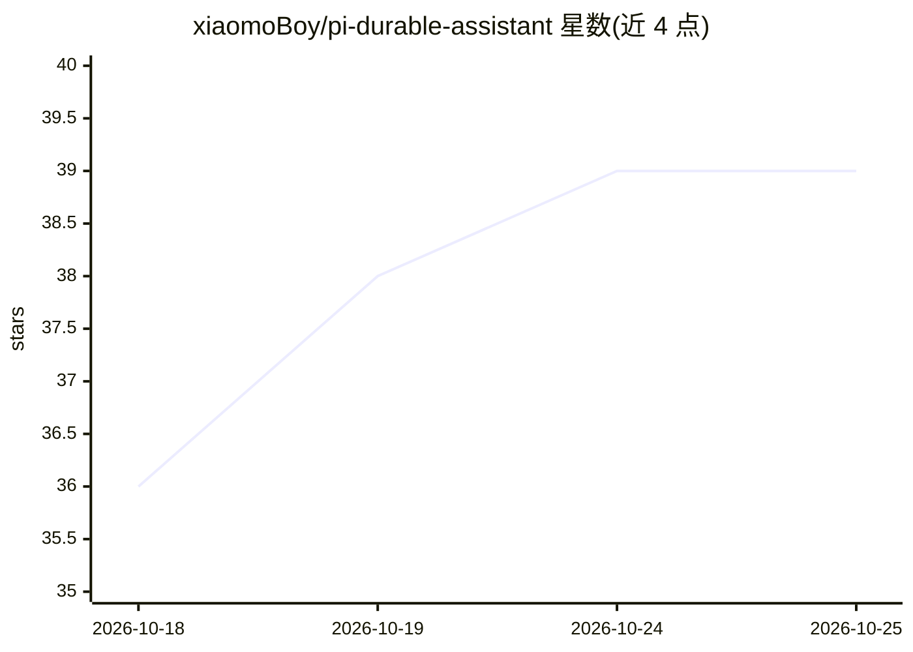

# xiaomoBoy/pi-durable-assistant

⭐ 39 · JavaScript · MIT · 推送 2026-10-11 · [GitHub](https://github.com/xiaomoBoy/pi-durable-assistant) · 个人维护 · 中文 README

**可自托管的持久化个人 AI Agent，进程重启后恢复任务**

基于 Pi Durable 构建的自我托管个人 Agent 应用：任务与会话状态持久化到 SQLite，进程崩溃或重启后可恢复执行；提供浏览器多会话聊天 UI（SSE 状态同步）、前台/后台 Subagents、一次性或按分钟间隔重复的计划任务、需批准的跨会话长期记忆、Obsidian 笔记只读检索，以及可选的微信 iLink 通道（文字与语音转写）。模型侧通过环境变量接入 openai-completions/openai-responses/anthropic-messages 兼容 API，另有无需 API Key 的本地模拟剧本模式。附带 Docker Compose 部署路径，README 声明为个人单用户实验性项目，生产使用需自行处理 HTTPS、访问控制与备份。

## 筛选速览

| 维度 | 判定 | 备注 |
|---|---|---|
| AI 角色 | `ai-native` | 本体是模型或模型工具 |
| 许可风险 | `permissive` | MIT |
| 部署形态 | `self-host` | docker 或自建部署 |
| 模型依赖 | — | README 未给出锁定关系 |
| 硬件要求 | — | 无带数字的原话,不猜 |
| 安装摩擦 | `low` | 无编译、无系统依赖或容器化 |
| 成熟度 | `idea` | |

## 能力要点

- SQLite 持久化与进程重启后的任务断点恢复
- 前台/后台 Subagents 与可暂停/恢复/取消的计划任务
- 需任务中心批准的跨会话长期记忆机制
- 可选微信 iLink 通道与 Obsidian 白名单只读检索

## 适用场景

- 让个人 Agent 在服务器上长期运行后台任务，重启后不丢进度
- 通过浏览器或微信与自己的助理对话、收提醒
- 自托管一个带长期记忆的私人 AI 助理

## 场景标签

 · 领域:个人 AI Agent/自托管应用

## 证据(README 行号)

> L3: **可自托管的持久化 AI Agent（Durable AI Assistant）**：基于 Pi Durable 构建，支持进程崩溃后恢复任务、长期后台执行、Subagents、多会话 Web UI、定时任务和可选的微信 iLin
> L17: 普通聊天机器人在进程退出后往往丢失正在执行的工作。这个项目把 Pi Durable 的任务、会话和 Document 持久化机制封装为**一个可以打开浏览器实际使用的个人 Agent**。可在任务进行中重启进程，再查看恢复后的执行
> L66: 支持 `openai-completions`、`openai-responses` 和 `anthropic-messages` API 类型。兼容性取决于实际模型/服务商；模型费用由外部服务商或中转平台收取。请查看 配置说明 

## 星数曲线

2026-10-18 36 → 2026-10-25 39（+3）

---
*卡片 v1 · prompt 1.4 · 生成 2026-10-25 · 置信度 high · 依据 README sha `f269a1cd9886` · [字段定义](../../DATASET.md)*
